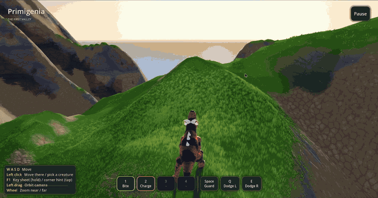

<h1 align="center">Primigenia</h1>

<p align="center">
  <b>Start in a tide pool. Walk out of the sea. Reach the stars.<br>Whatever you became on the way comes with you.</b>
</p>

<p align="center">
  <a href="https://diegoatencia.dev/primigenia/"></a>
  <br>
  <sub>The first valley, creature stage, desktop build. <a href="https://diegoatencia.dev/primigenia/">Full video and the idea behind the game →</a></sub>
</p>

<p align="center">
  
  
  
  
  <a href="LICENSE"></a>
  
</p>

An **evolution game** across six stages, **cell → creature → band → realm →
industry → space**, where what you became early still matters among the stars.
An aquatic lineage settles ocean worlds without terraforming them. A
void-adapted one flies unpressurised ships. A silk-spinner reaches the space
elevator early.

It is also an **RL environment and LLM benchmark**. Everything runs on one
deterministic C simulation (same seed and inputs give the same world, bit for
bit), so humans in the Godot build, language models through JSON and verbs, and
RL policies through float vectors all play the same game. The headline question:
**how fast can an agent win the full arc?**

| | |
|---|---|
| **Playable now** | The creature stage: the island, the creature studio, combat, and the social loop (befriend, observe, intimidate, eat) |
| **Designed** | Cell, Band, Realm, Industry and Space ([docs/ARC-PLAN.md](docs/ARC-PLAN.md)) |
| **Agents** | Python ctypes binding, Gymnasium envs, PufferLib binding, and the `TextLand` LLM face |
| **Trust** | Every run writes a replay that anyone can re-simulate bit for bit |

MIT-licensed code, CC BY 4.0 art, fully original naming. An independent fan
tribute to the evolution games that inspired it; **not affiliated with Maxis or
EA**.

---

## How to build

```bash
make            # core library, C tests, bench binary
make test       # C tests + core dependency check
make smoke      # Python binding smoke test
make bench      # steps/s
make studio     # the legacy SDL creature studio (needs libsdl2-dev libepoxy-dev)
make godot      # the Godot desktop build (needs Godot 4.7 and godot-cpp; godot/README.md)
make wasm       # WASM: combat, terrain, world (requires Emscripten)
make wasm-test  # WASM parity + browser test
make terrain-test # 1024-gen guarantees, WASM parity, metrics
make stage      # stage builder (copies assets into place)
make blender    # Blender with the local LLM/MCP design bridge
```

Emscripten must be available — either `emcc` on `PATH` or installed at
`~/emsdk/emsdk_env.sh`. The native build needs nothing extra.

To let Kimi or another vision-capable MCP model inspect, model, render, revise,
and export Blender assets, see
[docs/BLENDER_MCP.md](docs/BLENDER_MCP.md). The project-level Kimi MCP
configuration is included; run `make blender` first.

## How to play

### Desktop build (Godot)

```bash
make godot && godot --path godot
```

The desktop build is the game proper: main menu, the island stage and the
creature studio. Build dependencies and the full controls are in
[godot/README.md](godot/README.md).

### Web build

```bash
make serve      # starts an http server on port 8090
```

Then open in your browser:

| Page | URL |
|---|---|
| Creature creator (studio) | `http://127.0.0.1:8090/web/studio/` |
| Creature stage (game) | `http://127.0.0.1:8090/web/stage/` |
| Terrain generator lab | `http://127.0.0.1:8090/web/terrain-lab/` |

**Web stage controls** — see
[docs/evidence/stage/polish/README.md](docs/evidence/stage/polish/README.md)
for the full movement, combat, camera, touch and audio details.

## How to verify

```bash
make check        # runs C tests → WASM → terrain → studio → stage (browser)
make serve        # serve on port 8090
make play         # prints the playable URLs above
```

`make check` requires Playwright (check `NODE_PATH`). It starts a local
server for the browser tests automatically and tears it down afterwards.

## Documentation

| File | What |
|---|---|
| [docs/DESIGN.md](docs/DESIGN.md) | All design decisions (Q1–Q57, G1–G62, W1–W13) — the source of truth |
| [docs/BACKLOG.md](docs/BACKLOG.md) | Per-item state, milestones, acceptance criteria (the plan of record is [docs/CREATURE-ROADMAP.md](docs/CREATURE-ROADMAP.md)) |
| [docs/CREATURE-ROADMAP.md](docs/CREATURE-ROADMAP.md) | The creature stage plan of record (phases C0–C9) |
| [docs/godot/](docs/godot/) | Godot desktop frontend: interfaces (WIRE.md, M0.md…), NAV, FEEL, ROCK, ACTIONS, STUDIO, DEVTOOLS |
| [docs/P4.md](docs/P4.md) | Phase-4 spec: social depth, Q43 loop, discovery, tiers, recipes, editing |
| [docs/COMBAT.md](docs/COMBAT.md) | Creature combat move data, profiles, balance notes |
| [docs/WORLD.md](docs/WORLD.md) | G56 world simulation: entities, terrain, encounters |
| [docs/TERRAIN.md](docs/TERRAIN.md) | Eroded terrain generator (W11–W13) |

## Layout

| dir | what |
|---|---|
| `core/` | the simulation, libc + libm only, no graphics (`make check-core` enforces it) |
| `bindings/python/` | ctypes binding, Gymnasium envs, `Campaign`, the `TextLand` LLM face |
| `bindings/puffer/` | PufferLib-native binding |
| `tests/`, `apps/` | C test suite, benchmarks, CLI tools, and wasm API helpers |
| `studio-sdl/` | legacy SDL2/GL creature studio (superseded by Godot `godot/studio`, G76) |
| `godot/` | desktop game: island stage, studio, creatures, actions, dev tools (see [godot/README.md](godot/README.md)) |
| `art/reference/` | the visual and rules references (`valle-primigenio.html`, etc.) |
| `web/studio/` | creature creator: sculptable spine, Build/Paint/Test, 3D part palette, procedural IK legs, 24 Blender GLBs, growth regions, undo/redo, JSON, sharing, es/en |
| `web/stage/` | creature stage: terrain, movement, encounter combat, P4 social loop |
| `web/terrain-lab/` | terrain generator preview (WASM, no Node install needed) |
| `web/engine/` | shared engine: simulation, species, combat, audio, i18n |
| `assets/audio/` | public-domain / free-licence audio files (CC0 preferred, CC BY with credits) |

### Creature creator (web studio)

The creator lets you sculpt a spine, place cosmetic parts from 9 categories
(24 Blender GLBs), paint patterns, and grow body regions (horns, plates,
tendrils). Imports, exports and share-links use a versioned genome schema
(`cpore.creature/4`). Three.js r128 is loaded from cdnjs; offline use
requires vendoring the script.

### Creature stage (web game)

The stage renders the eroded valley (W11 terrain), places a player creature
and wild NPCs, runs combat through the C/WASM core, and exposes the P4 social
loop (singing, befriending, dominating, DNA economy, advance). WASD/arrows
move; space guards; Q/E dodge; camera orbits with right-drag or scroll.

### Godot desktop game

The desktop build in `godot/` is the one playable game going forward (G76):
main menu, the island stage with real creatures and the creature studio. See
[godot/README.md](godot/README.md) for build dependencies, controls and the dev
tools.
