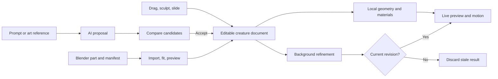

# Generative creature creator — functional design

Status: implementation design, 2026-11-12. This is the intended experience;
the delivery table distinguishes it from the current implementation.
See [rendered evidence and validation](evidence/creator-validation.md) for the
reference captures, prototype checks, and limits of the performance measurements.

## Capability and visual authority

An artist or player builds a living creature by placing, sliding, growing, and
sculpting anatomy directly on its body. The creator generates new geometry,
attachment tissue, surface detail, and a usable rig as they work. Editing
should feel as immediate as moving a part in Spore while allowing much wider
anatomy and artistic expression. The artist controls silhouette, local detail,
symmetry, variation, and what generation may change.

`art/reference/taller-de-criaturas.html` is byte for byte the supplied latest
`~/Descargas/taller-de-criaturas(1).html`. Its rendered appearance was verified
in Chromium on 2026-11-12: a warm outdoor valley, patterned scaly skin, expressive
faces, and a moving creature beside a dark workbench. The earlier black Firefox
captures were insufficient evidence. Preserve this visual starting point.

Greater realism means coherent anatomy and materials: shoulders and hips that
grow into the body, tissue around joints, distinct skin/keratin/membrane
surfaces, and movement that fits the form. Photorealism can be an artistic
direction; biological plausibility is an optional assist. Neither restricts
fantasy anatomy or requires every creature to share one aesthetic.

## Authoring loop

1. Start with a seed body, saved creature, or blank spine. Choose bilateral,
   radial, or independent symmetry. Defaults do not fix the number of limbs,
   heads, tails, or body branches.
2. Place a part family: limb, mouth, eye, horn, shell, wing, fin, tendril, or
   surface growth. A contact preview shows its footprint and mirrored copies.
   Click placement and keyboard commands provide alternatives to dragging.
3. Slide the root over the body. It follows the surface normal and regenerates
   its local transition. Pull the tip for reach, move joints for articulation,
   and adjust thickness with a handle or numeric value. Keep camera and
   unaffected anatomy stable.
4. Change branching, taper, curvature, density, tissue thickness, muscle
   fullness, or coverage. This adds geometry such as branches, digits, plates,
   and membrane spans; it does more than scale a fixed library mesh.
5. Select a region and request variations. Lock its outline, attachment,
   palette, or individual details. Compare variants on the same creature,
   accept one, or restore the previous state.
6. Walk, run, turn, crouch, and pose in the same viewport. A drag steadies the
   pose temporarily. Motion adapts to the anatomy; unsupported rigs are clearly
   identified. Editing does not require leaving the scene.
7. Save the editable design, export a renderable asset, or validate it for the
   game. Returning from a test preserves design, history, and camera.

### Functional acceptance scenarios

| Operation | Immediate behavior | Generated result | Artist control |
| --- | --- | --- | --- |
| Slide forelimb up flank | Root follows cursor on surface | Shoulder volume and skin transition fit new root | Lock hand and limb proportions |
| Pull horn tip | Length and curve follow tip | Taper, ridges, branches, root tissue update | Preserve seed and branches until explicitly changed |
| Spread wing tips | Skeleton and outline update | Membrane fills span; folds follow tension | Pin outline or draw a new one |
| Brush a scale patch | Coverage appears under brush | Scales follow surface flow with bounded variation | Density, size, direction, palette, erase mask |
| Add a second head | New branch and head appear | Neck transition and rig branch form | Independently edit each head |
| Request coral-like horns | Current creature stays interactive | Regional candidate forms arrive | Accept, reject, or edit recipe |
| Increase realism | Preserve current silhouette | Propose local folds, materials, asymmetry, joint detail | Choose layers and strength; one-step undo |

These scenarios define the target, not features already implemented.

## Workspace and gestures

The creature takes the largest area. Keep the reference's valley and warm
workbench. A compact parts library sits beside the viewport; the selection
inspector shows the active part or region. Body, Parts, Surface, and Motion
are tools in the same scene. Candidates appear in a tray beside the inspector
and never replace the creature automatically.

Show the selection through a restrained outline and distinct root, joint, tip,
and radius handles. Empty-space dragging or the orbit tool moves the camera;
part dragging cannot accidentally orbit. Escape restores the gesture's start
state. Release creates one undo entry. Undo restores exact seeds and accepted
assets. Numeric values and arrow-key nudges support keyboard editing. Touch
uses an explicit edit/orbit choice and bottom inspector without hover-dependent
gestures. All controls and status messages support es/en.

Symmetry is a relationship with stable IDs. Moving a master updates its copies;
breaking symmetry detaches one copy. Pin areas against global changes, mirror
regional edits, and vary a region without destroying saved variants.

Art mode allows designs beyond game budgets. Play validation reports abilities,
unsupported anatomy, and DNA constraints, offering fixes while preserving the
original. The authoring viewport must not reject art because the current C
stage supports sixteen part slots.

## Generation behavior

The recommended architecture combines procedural generation and AI. The AI
role remains an owner preference; no provider is selected or connected yet.



| Mechanism | Suitable output | Timing | Contract |
| --- | --- | --- | --- |
| Procedural recipes | New branches, digits, plates, fins, tissue transitions, scales | During dragging/sliding | Local, stable seed, immediate preview |
| Specialized learned decoder | Rich variations within a supported family | During manipulation only after measurement proves the budget | Explicit family and topology limits |
| AI proposal | New family, silhouette concept, regional geometry or materials | Explicit request or opt-in idle refinement | Cancellable, tied to revision, separately accepted |

Dragging never waits for the network. An accepted AI shape becomes a locally
editable asset. It needs an attachment, deformation cage, stable material
coordinates, and rig metadata before it can behave as an editable body part.
An arbitrary generated mesh does not automatically have these properties.
Failed fitting leaves the candidate in the tray with an actionable explanation.
A prompt-to-keyword switch must never be presented as an actual AI model.

Continuous neural generation while dragging remains a research track until a
specific model/hardware combination proves latency, local edit preservation,
and temporal consistency. Fast neural rendering does not establish fast
synthesis of new anatomy.

AI can also propose an editable *recipe*, rather than a finished mesh. A prompt
such as “forked coral horns with thin translucent tips” can yield a structured
graph of approved operations: sweep, branch, loft, repeat, blend, coverage, and
material layers. The editor validates and executes that graph locally. Exposed
parameters become ordinary handles/sliders; accepted recipes keep working
without another model call. Each graph declares complexity bounds and affected
regions. Model output is data, not arbitrary executable browser code. New
primitive implementations require an authored and tested generator plugin.
This is a promising route to AI-assisted novelty with fast subsequent editing;
its artistic quality still needs evaluation on real prompts and model output.

## Artist-authored parts and Blender

The current worktree also contains a Blender/MCP bridge and a sample part
authoring script under `tools/blender-mcp/`. They export visual GLBs and preserve
editable Blender scenes. They are useful authoring inputs; their presence does
not prove an editable part importer or procedural fitting in the studio.

Use a GLB plus a versioned part manifest as the first import package. The
manifest declares source/export coordinate frames, units, root footprint,
attachment axis, named joints, deformation cage or morph controls, exposed
parameters and bounds, material regions, LODs, provenance, and content hashes.
Preview orientation and scale before accepting it. The sample script's
`cpore_category`, attachment, axis, and suggested-ability metadata are starting
points, not authoritative simulation abilities. Verify axis conversion through
the actual exporter rather than assuming Blender and glTF use the same basis.

Imported parts enter a personal library with editable tags and previews. An
artist can place a rigid visual part immediately; deformation, animation, and
generative controls become available only when the corresponding data is
present or successfully fitted. Keep the original asset and the fitted recipe.
Export both a portable GLB for other art tools and the editable creature
document for round trips. A GLB alone cannot preserve every generator rule,
artist pin, or procedural edit history.

## States, history, and failure recovery

| State | Visible behavior | Exit |
| --- | --- | --- |
| Ready | Accepted creature and selection | Begin edit/request variants |
| Dragging | Coarse geometry follows pointer | Release commits; Escape restores |
| Refining | Preview stays editable as detail finishes | Matching revision swaps atomically |
| Proposing | Current creature works; cancel available | Candidates arrive in tray |
| Comparing | Candidate previews in selected region | Accept is one transaction; reject restores |
| Stale result | Cannot overwrite newer edits | Keep as detached variant only if reusable |
| Failure | Last valid creature remains | Retry, reduce scope/detail, dismiss |
| Motion test | Same creature animates | Edit steadies pose; return preserves view |

Local recipe determinism means the same document, seed, generator version, and
quality reproduce the topology and detail placement. AI results are immutable
saved assets with provenance; reopening a creature never requires regenerating
them. Skin detail stays anchored through motion. Selection and pins use stable
surface references rather than raw vertex indices that remeshing can destroy.

## Document and interfaces

One versioned creature document is the source of truth. It contains:

- An anatomy graph with stable node IDs, parent/surface attachments,
  centerlines, radius profiles, joint intent, and symmetry relationships.
  Multiple body branches and heads are permitted.
- Regional recipes: family/version, seed, parameters, anchor, coverage mask,
  artist pins, and detail layers.
- Materials: base color, markings, roughness, normal/displacement, subsurface
  approximation, optional emission, and stable coordinates.
- Rig/motion intent: limits, limb roles, contact targets, gait groups, and
  handling for appendages without locomotion roles.
- Accepted external assets: content hash, provenance, fitting data, and source
  region/revision. Generated meshes are derived data.
- Game projection mapping anatomy to supported capabilities. The C validator
  owns cost and legality; cosmetic detail cannot grant abilities.

Authoring data and the game projection live in the same document. This extends
DESIGN.md Q47 without losing artistic detail that the current Cp4Genome cannot
represent. Save/share preserve the full document. Game entry requires a
supported projection; migrations report losses and preserve the original.

```text
request = {documentId, revision, regionId, generatorVersion, seed,
           recipe, pinnedConstraints, quality, jobId}
result  = {jobId, revision, regionId, recipeHash, buffers, bounds,
           attachmentMap, rigHints, diagnostics, timings}
```

Accept a result only if document, region, revision, and recipe hash still match.
Keep at most one active local job plus the latest queued request per region.
Discard superseded results. Upload buffers atomically and dispose replaced
geometry after swapping. Move expensive geometry work off the UI thread and
transfer typed buffers instead of serializing large vertex arrays as JSON.

## Geometry and materials

Use a centerline graph and analytic volumes for bodies/attachment transitions,
swept surfaces for horns/limbs/tendrils, spans for fins/membranes, and instanced
detail for scales/feathers/plates. Families expose meaningful artistic controls.
Local implicit blends join root tissue; only the affected region is remeshed.
A coarse root preview can precede refinement.

Preserve intent during remeshing using anchors/masks relative to the anatomy
graph. Rebuild local skinning weights and verify seams, normals, stable detail
coordinates, and joint motion. Global retopology on every pointer event cannot
be a dependency of immediate interaction.

Extend the reference skin with distinct tissue types and macro/micro scales.
Muscles and folds that change silhouette need geometry. Fine pores/scales
usually belong in shading. Avoid uniform detail everywhere; joints, mouths,
eyes, and contact areas need their own anatomy rules.

## Performance budgets and verification

These are targets, not measured current performance. Every result must name
device, browser, viewport, render scale, and quality.

| Measurement | Desktop p95 | Phone/tablet p95 |
| --- | --- | --- |
| Input to submitted frame containing edit | 33 ms | 66 ms |
| Immediate geometry CPU work | 4 ms | 8 ms |
| Release to refined geometry visible | 200 ms | 400 ms |
| Steady frame time, one editing creature | 16.7 ms | 33.3 ms |

Submitted-frame timing is a software proxy. Physical input-to-photon claims
need a separate display-latency test. Network ping applies to AI requests and
does not describe local editor response.

Record p50/p95/worst for cold shaders, root dragging, density changes, maximum
branches, undo during generation, cancellation, and editing during animation.
Include memory stabilization and default/stress creatures. Pair performance
results with screenshots at identical settings. A geometry microbenchmark
cannot establish the full editor's frame rate.

Reduce scenery, shadows, and pixel ratio before editing clarity. Over-budget
recipes show faithful coarse previews while refining. Quality controls use
plain language. Do not fabricate latency values or replace detailed art with
an unrelated simpler shape.

## Current evidence, conflicts, and delivery

The current studio has the reference renderer, procedural walking, one fixed
body chain, a small library, local history, JSON, sharing, and es/en. Shape edits
are coalesced per frame and preserve zoom. Web and C genomes differ. Studio
ability values are JavaScript estimates, not evidence of C validation.

DESIGN.md Q1 remains benchmark-first for the simulation. This request broadens
the creator's artistic freedom. The creator must exceed present C part limits
while retaining an explicit validated game projection. Q42 establishes web
first; Q49's shared C/WASM generation remains the runtime target. A JavaScript
prototype does not complete that port.

| Gate | Required proof | Current state |
| --- | --- | --- |
| Reference and functional design | Rendered reference; gestures, generation, states, document, latency specified | Reference visually inspected; contract here |
| Generative edit loop | Place/slide generated parts, change topology, undo/reload exact result | Independent torso/neck/tail regions with horn branches, plates, tendrils; add/select/duplicate/delete, cached geometry and exact history |
| Coherent anatomy | Blended roots, multiple branches, artist pins preserved | Not implemented |
| Artistic control | Regional variants, masks, locks, symmetry breaks, layered materials | Independent seeds, recipes, placement and symmetry implemented; masks, locks and material layers pending |
| AI participation | Actual model output, fitting, accept/reject, provenance, stale protection | Model choice and integration pending |
| Living creature | Supported plans animate with contacts/limits after edits | Reference gait only |
| Shared document and game | Full art round trip, C validation, same creature in game | Not implemented |
| Performance and recovery | Device traces, touch editing, memory, recoverable failures | Not measured end to end |

The next anatomy work is blended shoulders/hips, imported-part attachment,
and generalized limbs. These are increments toward the full creator, not
substitutes for its wider artistic control and AI requirements.

The local loop lives in `web/studio/growth.js` and the studio. It generates
new mesh topology, preserves seeded variants, supports direct root dragging and
keyboard placement, and keeps surface patterns anchored. The November 13 update
adds independently editable regions on the torso, neck and tail. Selecting a
region changes editor state only. Duplicating preserves its recipe and seed
under a new stable ID; adding, duplicating, deleting, and dragging are reversible
transactions. The inspector controls the selected region and amber root markers
identify it on the creature.

Each region owns a geometry cache. Position, surface, coverage, angle and symmetry
reuse mesh buffers. Shape changes regenerate only that region; girth changes
regenerate all regions because the generated mesh scale depends on body girth.
Region deletion disposes its buffers. The current authoring guard allows up to
64 regions; this is an editor resource limit, not a gameplay DNA restriction or
a validated performance promise at that count.

The web document now exports `cpore.creature/3` with a `regions` array:

```js
{
  id: "region-1", schema: "cpore.growth/1",
  family: "horns", seed: 491, count: 9, length: 1.25,
  curve: 0.65, branches: 3,
  surface: "torso", position: 0.6, coverage: 0.75,
  angle: 0.55, mirror: true
}
```

IDs must be unique. Version 1 imports migrate without growth; version 2's
single recipe becomes `region-1` on the torso, or an empty region list for
`family: "none"`. Invalid imports leave the design unchanged. The schema version
changes so older clients reject new designs instead of silently losing regions.
Selection is not serialized into the art document.

The prototype still has three bounded families and a fixed body chain. Roots
have overlapping skin collars rather than unified tissue. There is no AI
provider, generalized anatomy graph, regional painting, or imported-part editor
in the studio. The separate Blender library has 24 GLBs and source-space
attachment metadata; future importing must convert the glTF coordinates,
retain provenance, and distinguish fixed mesh assets from editable recipes.

## Research basis and open choices

Microsoft's [TRELLIS.2](https://github.com/microsoft/TRELLIS.2) reports about 3 s
at 512³, 17 s at 1024³, and 60 s at 1536³ on H100. These model-specific numbers
are not end-to-end service guarantees. They support asynchronous proposals as
a practical initial path. NVIDIA's [Neural Geometric Level of Detail](https://research.nvidia.com/labs/toronto-ai/nglod/)
demonstrates efficient neural surface rendering; it does not establish the
generation latency required here.

[MDN Web Workers](https://developer.mozilla.org/en-US/docs/Web/API/Web_Workers_API/Using_web_workers)
and [transferable objects](https://developer.mozilla.org/en-US/docs/Web/API/Web_Workers_API/Transferable_objects)
document the background work and buffer ownership model.

Open choices: AI's role during continuous interaction, first target device/GPU,
remote generation budget, and the first AI provider/decoder. These do not block the
local procedural editing loop or editable document design.
