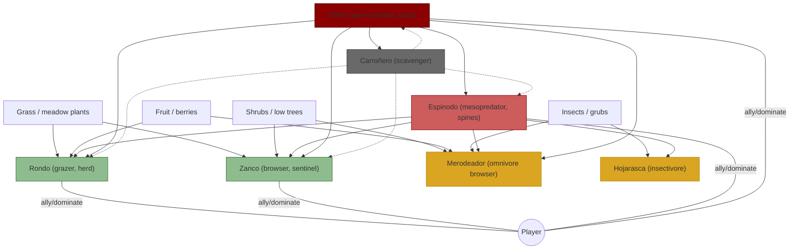
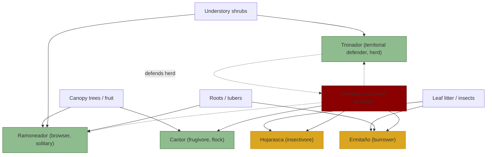
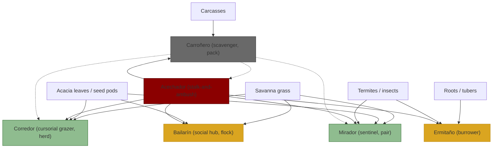
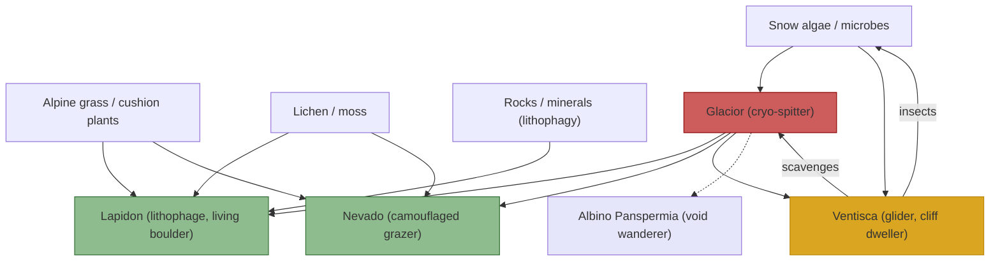
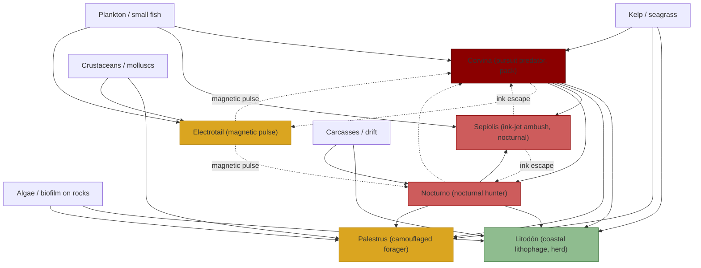
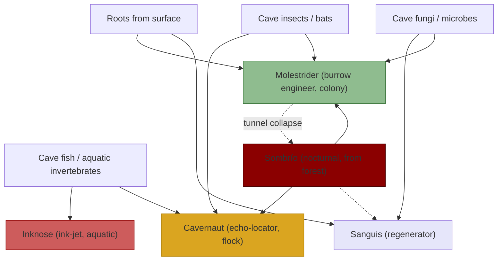

# Primigenia — Island Creature Roster (Ecology Design Data)

> **Scope:** Design data only — no engine code. This document is the creature roster for the island described in DESIGN.md W2 (meadow valley, forest, savanna/desert, alpine, coast & shallow sea; plus caves, night, islets). It feeds `web/stage/species/roster.json` (machine-readable) and the C world generator.
>
> **Sources:** DESIGN.md (Q43, G11, G18–G37, G49–G54, G65, G68, W1–W15), P4.md (species profiles, temperaments, DNA, part drops), eggs/brainstorm-a.md & brainstorm-b.md (secret moves, easter eggs), CALIBRATION.md (population & DNA calibration), WORLD.md (world foundation), web/stage/species/garfio.json, web/studio/parts.json (part ids, categories, c_type).
>
> **Naming convention:** Spanish-flavoured original names (like the valley's Merodeador, Garfio, Rondo, Zanco, Espinodo). Temperaments from P4 Q-20: 0 **timid** (never initiates, flees at < 50 % HP), 1 **territorial** (hostile inside 8 m + body radius unless allied), 2 **aggressive** (hostile inside 28 m unless allied).
>
> **Part ids** come from `parts.json`; `drops` are subsets the player can obtain on kill (G37: 20 % common, 35 % Garfio, pity on 4th dry kill). `clue` is the recipe hint the species carries or demonstrates (G51, G68: rock armour, bone spines, meteor shards, nocturnal).

---

## 1. Species Roster by Biome

### 1.1 Meadow Valley (Start Biome) — 5 species
*Existing valley species from the reference prototype + 1 new nocturnal variant.*

| # | Name | Role | Diet | Size | Temper | Activity | Social | Parts Carried | Drops | Clue | One-Line Behaviour | Real-World Inspiration |
|---|------|------|------|------|--------|----------|--------|---------------|-------|------|-------------------|------------------------|
| 1 | **Merodeador** | Browser / opportunist | Omnivore | Medium (1.8 m) | 1 territorial | Day | Pair / loose herd (3–5) | `pico`, `ojo`, `pata`, `cresta`, `arm_grasper` | `pico`, `ojo`, `pata` | — | "Strolls the valley edge, snapping at fruit and scavenging carcasses; its crest flashes when it spots you." | Coati + peccary |
| 2 | **Garfio** | Apex predator (valley) | Carnivore | Medium (2.0 m) | 2 aggressive | Day | Pack (3–4) | `fauces`, `ojo`, `cresta`, `arm_grasper`, `pata`, `cuerno`, `tail_spike` | `arm_grasper`, `cresta`, `fauces` | **Bone spines** (wild Espinodo volley demo) | "Circles at 28 m, then charges; its nipping jaw and hooked tail make every fight a dance of bleed and guard." | Smilodon + spotted hyena |
| 3 | **Rondo** | Grazer / herd core | Herbivore | Small (1.2 m) | 0 timid | Day | Herd (5–8) | `romo`, `tallo`, `pezuna`, `ojo` | `pezuna`, `ojo` | **Pack rally** (trumpet snout + ear scoop) | "Hums a low chord while grazing; when one sings, the herd answers — and Garfio thinks twice." | Capybara + guinea pig |
| 4 | **Zanco** | Browser / sentinel | Herbivore | Medium (1.6 m) | 0 timid | Day | Herd (4–6) | `pico`, `zanca`, `aleta`, `ojo` | `aleta`, `zanca` | **Pack rally** (trumpet snout + ear scoop) | "Stands tall on stilt legs, whistling at shadows; its fin-fringe catches the wind like a flag." | Gerenuk + black-winged stilt |
| 5 | **Espinodo** | Mesopredator / spine user | Carnivore | Medium (1.7 m) | 1 territorial | Day | Solitary / pair | `mandible_shear`, `pua`, `cuerno`, `tail_hammer`, `pata` | `cuerno`, `tail_hammer`, `pua` | **Bone spines** (fires spine_volley; spined fossil & carcass clues) | "Arches its back, dorsal spines rattling — then a volley of bone needles pins you to the grass." | Porcupine + thylacine |

---

### 1.2 Forest — 5 species

| # | Name | Role | Diet | Size | Temper | Activity | Social | Parts Carried | Drops | Clue | One-Line Behaviour | Real-World Inspiration |
|---|------|------|------|------|--------|----------|--------|---------------|-------|------|-------------------|------------------------|
| 6 | **Ramoneador** | Browser / bark stripper | Herbivore | Large (2.5 m) | 1 territorial | Day | Solitary / pair | `trompa`, `oreja`, `pata`, `placa`, `frill_fan` | `trompa`, `placa`, `frill_fan` | **Rock armour** (mineral fossil clue on fallen logs) | "Peels bark with its trunk, then stands motionless — its dorsal plates have fused with the stones it ate." | Tapir + glyptodont |
| 7 | **Sombrío** | Ambush predator | Carnivore | Medium (1.8 m) | 2 aggressive | **Night** | Solitary | `mandible_shear`, `eye_stalk`, `leg_sprinter`, `tail_spike`, `cresta` | `eye_stalk`, `tail_spike`, `leg_sprinter` | **Nocturnal** (glowing eyes at night; night-befriend bonus) | "Its stalk-eyes glow amber in the dark; you hear the pounce before you see the shadow." | Ocelot + tarsier |
| 8 | **Cantor** | Frugivore / seed disperser | Herbivore | Small (0.9 m) | 0 timid | Day | Flock (6–10) | `pico`, `snout_trumpet`, `zanca`, `lure_lantern` | `snout_trumpet`, `lure_lantern` | **Pack rally** (duets with Rondo at forest edge) | "Sings in counterpoint with the valley's Rondos; the lantern on its forehead pulses to the rhythm." | Bellbird + toucan |
| 9 | **Hojarasca** | Insectivore / leaf-litter forager | Insectivore | Tiny (0.5 m) | 0 timid | Day | Solitary | `antena`, `pata`, `bulbo`, `excavadora` | `antena`, `bulbo`, `excavadora` | **Ink jet** (carcass clue: ink sac in cheek pouches) | "Rustles through dead leaves, antennae twitching; when startled, a dark cloud puffs from its cheeks." | Shrew + salamander |
| 10 | **Tronador** | Territorial defender | Herbivore | Large (2.8 m) | 1 territorial | Day | Herd (3–5) | `rombo`, `asta`, `pezuna`, `shell_plate`, `arm_smasher` | `asta`, `shell_plate`, `arm_smasher` | **Lithosuit** (alpine fossil clue carried down by river) | "Shakes the ground with each step; its dorsal shield is layered stone, and its smashing arm cracks trunks." | Forest elephant + stegosaur |

---

### 1.3 Savanna / Desert — 6 species

| # | Name | Role | Diet | Size | Temper | Activity | Social | Parts Carried | Drops | Clue | One-Line Behaviour | Real-World Inspiration |
|---|------|------|------|------|--------|----------|--------|---------------|-------|------|-------------------|------------------------|
| 11 | **Corredor** | Cursorial grazer | Herbivore | Medium (1.5 m) | 0 timid | Day | Herd (8–12) | `romo`, `zanca`, `foot_spring`, `oreja` | `foot_spring`, `oreja`, `zanca` | — | "Runs in perfect unison; a single alarm call and the herd becomes a dust cloud at 12 m/s." | Springbok + pronghorn |
| 12 | **Acechador** | Stalk-and-ambush predator | Carnivore | Medium (1.9 m) | 2 aggressive | **Day + Night** | Pair | `fauces`, `eye_triad`, `leg_sprinter`, `tail_hammer`, `cresta` | `eye_triad`, `tail_hammer`, `leg_sprinter` | **Mirror move** (watches fights, copies moves) | "Crouches in golden grass, three eyes tracking you — then it uses *your* charge against you." | Cheetah + mantis shrimp |
| 13 | **Carroñero** | Scavenger / bone crusher | Scavenger | Medium (1.4 m) | 1 territorial | Day | Pack (4–6) | `mandible_shear`, `pua`, `pata`, `sac_spitter` | `mandible_shear`, `pua`, `sac_spitter` | **Bone spines** (carcass clue: quill wounds on kills) | "Laughs in clicking chirps as it crushes femurs; its spitter sacs spray acid to soften marrow." | Hyena + vulture |
| 14 | **Ermitaño** | Burrower / root eater | Herbivore | Small (0.8 m) | 0 timid | Day | Solitary / pair | `trompa`, `excavadora`, `pezuna`, `placa` | `excavadora`, `placa`, `pezuna` | **Burrow collapse** (digging claw + heavy tail fossil clue) | "Digs spiral burrows under acacia roots; when a predator enters, the roof falls — and it's gone." | Aardvark + naked mole-rat |
| 15 | **Bailarín** | Display specialist / social hub | Omnivore | Small (1.0 m) | 0 timid | Day | Flock (10–15) | `pico`, `frill_fan`, `foot_hoof`, `lure_lantern` | `frill_fan`, `foot_hoof`, `lure_lantern` | **Pack rally** (leads multi-species dawn chorus) | "Its neck fan cycles through colours at dawn; Rondos, Corredores, even Carroñeros pause to watch." | Bird-of-paradise + manakin |
| 16 | **Mirador** | Sentinel / alarm caller | Herbivore | Medium (1.6 m) | 1 territorial | Day | Pair | `tallo`, `oreja`, `leg_sucker`, `placa` | `tallo`, `oreja`, `leg_sucker` | **Magnetic navigation** (magnetos fossil clue in termite mounds) | "Stands on a termite mound, stalk-eyes scanning; its horn hums with the planet's field." | Meerkat + dik-dik |

---

### 1.4 Alpine (Rock & Snow) — 5 species

| # | Name | Role | Diet | Size | Temper | Activity | Social | Parts Carried | Drops | Clue | One-Line Behaviour | Real-World Inspiration |
|---|------|------|------|------|--------|----------|--------|---------------|-------|------|-------------------|------------------------|
| 17 | **Lapidon** | Lithophage / living boulder | Herbivore (lithovore) | Large (2.2 m) | 1 territorial | Day | Herd (3–4) | `beak_crusher`, `shell_plate`, `excavadora`, `placa`, `frill_fan` | `beak_crusher`, `shell_plate`, `excavadora` | **Rock armour** (wild demo: eats stones, becomes boulder; mineral fossil & carcass clues) | "Chews granite like cud; when threatened, pulls in its limbs and *is* a rock — 40 % damage reduction." | Mountain goat + armadillo + gastrolith dinosaur |
| 18 | **Glacior** | Cryo-spitter / alpine hunter | Carnivore | Medium (1.8 m) | 2 aggressive | Day | Solitary | `sac_cryo`, `sac_spitter`, `leg_gecko`, `tail_spike`, `cresta` | `sac_cryo`, `sac_spitter`, `leg_gecko` | **Freeze breath** (ice-age fossil & carcass clues) | "Breathes a cone of frost that pins legs to ice; then shatters the frozen with a horn charge." | Snow leopard + spitting cobra |
| 19 | **Ventisca** | Glider / cliff dweller | Omnivore | Medium (1.5 m) | 0 timid | Day | Pair | `snout_trumpet`, `wing_glider`, `foot_gecko`, `oreja` | `wing_glider`, `foot_gecko`, `snout_trumpet` | **Panspermia shard** (shard #2 *Spread* at summit) | "Rides updrafts along cliff bands, trumpeting; its glider wings catch every thermal." | Andean condor + flying squirrel |
| 20 | **Nevado** | Camouflaged grazer | Herbivore | Small (1.1 m) | 0 timid | Day | Herd (5–7) | `romo`, `placa`, `foot_hoof`, `bulbo` | `placa`, `foot_hoof`, `bulbo` | **Camouflage** (adaptive skin + pattern sac; observational clue) | "Stands motionless on a snow patch — its plates shift to white; step closer and it vanishes." | Ptarmigan + Arctic hare |
| 21 | **Albino Panspermia** | Void-adapted wanderer | Any | Medium (1.7 m) | 0 timid | **Night** | Solitary | `rad_shield`, `insulation`, `placa`, `lure_lantern` | `rad_shield`, `insulation`, `placa` | **Panspermia survivor** (meteor shard #1 *Origin* at crater; iridescent plates glow at night) | "Its shell shimmers with starlight; it walks the crater rim at midnight, unbothered by cold or radiation." | Tardigrade + albino axolotl |

---

### 1.5 Coast & Shallow Sea — 6 species

| # | Name | Role | Diet | Size | Temper | Activity | Social | Parts Carried | Drops | Clue | One-Line Behaviour | Real-World Inspiration |
|---|------|------|------|------|--------|----------|--------|---------------|-------|------|-------------------|------------------------|
| 22 | **Litodón** | Coastal lithophage | Herbivore (lithovore) | Large (2.3 m) | 1 territorial | Day | Herd (3–5) | `jaw_crusher`, `carapace_stone`, `excavadora`, `aleta`, `tail_paddle` | `jaw_crusher`, `carapace_stone`, `excavadora` | **Rock armour** (wild demo: eats coastal stones, pulls into shell; mineral fossil & carcass clues) | "Grazes on wave-worn rocks, calcium meter rising; when Garfio bites, the shell holds — 40 % less damage." | Marine iguana + chiton + ankylosaur |
| 23 | **Corvina** | Pursuit predator (water) | Carnivore | Medium (1.9 m) | 2 aggressive | Day | Pack (3–4) | `fauces`, `aleta`, `tail_paddle`, `leg_sprinter`, `sac_spitter` | `aleta`, `tail_paddle`, `sac_spitter` | — | "Darts through kelp forests in a coordinated line; its spitter sacs blind prey before the bite." | Dorado + orca |
| 24 | **Sepiolis** | Ink-jet ambush | Carnivore | Small (1.0 m) | 1 territorial | **Night** | Solitary | `sac_ink`, `lure_lantern`, `leg_sucker`, `eye_stalk`, `frill_fan` | `sac_ink`, `lure_lantern`, `leg_sucker` | **Ink jet** (wild demo: ink cloud at predators; cephalopod fossil & carcass clues) | "Hovers in moonlight, lantern pulsing; when a Corvina strikes, a black cloud erases the hunt." | Cuttlefish + anglerfish |
| 25 | **Palestrus** | Camouflaged shore forager | Omnivore | Small (0.9 m) | 0 timid | Day | Solitary / pair | `skin_chroma`, `eye_zoom`, `pata`, `bulbo` | `skin_chroma`, `eye_zoom`, `pata` | **Chameleon shift** (wild demo: matches sand perfectly; chromatophore fossil & carcass clues) | "Walks the tideline, skin rippling through sand tones; only its shadow betrays it." | Flounder + chameleon + sandpiper |
| 26 | **Nocturno** | Nocturnal coastal hunter | Carnivore | Medium (1.6 m) | 1 territorial | **Night** | Pair | `mandible_shear`, `eye_triad`, `leg_sprinter`, `tail_spike`, `lure_lantern` | `eye_triad`, `tail_spike`, `leg_sprinter` | **Nocturnal** (Espinodo variant: glowing eyes, night stamina bonus, night-befriend trust bonus) | "An Espinodo in midnight colours — its volley fires faster at night, and it trusts those who meet it in darkness." | Night-heron + Espinodo variant |
| 27 | **Electrotail** | Magnetic pulse defender | Omnivore | Medium (1.7 m) | 1 territorial | Day | Solitary | `sac_electric`, `senses_magnetic`, `aleta`, `cresta`, `tail_paddle` | `sac_electric`, `senses_magnetic`, `aleta` | **Magnetic pulse** (wild demo: spark staggers Garfio; ferromagnetic fossil & social learning clues) | "Generates a visible spark at magnetic outcrops; raiders stagger, their charge paths scrambled." | Electric eel + magneto-receptive shark |

---

### 1.6 Caves (Cliff & Underwater Entrances) — 4 species

| # | Name | Role | Diet | Size | Temper | Activity | Social | Parts Carried | Drops | Clue | One-Line Behaviour | Real-World Inspiration |
|---|------|------|------|------|--------|----------|--------|---------------|-------|------|-------------------|------------------------|
| 28 | **Molestrider** | Burrow engineer | Herbivore | Medium (1.5 m) | 1 territorial | Day | Colony (6–10) | `excavadora`, `tail_heavy`, `oreja`, `placa` | `excavadora`, `tail_heavy`, `oreja` | **Burrow collapse** (wild demo: collapses tunnel on Garfio; burrow fossil & carcass clues) | "Digs a network under the forest; when raiders enter, the ceiling drops — and it surfaces behind them." | Naked mole-rat + wombat |
| 29 | **Cavernaut** | Echo-locator / cave guardian | Insectivore | Small (0.8 m) | 0 timid | **Night** | Flock (8–12) | `echo_organ`, `snout_trumpet`, `leg_sucker`, `bulbo` | `echo_organ`, `snout_trumpet`, `leg_sucker` | **Sonar pulse** (wild demo: clicks reveal hidden; echolocation fossil & social clues) | "Clicks in the dark — the sound paints the cave walls, and every creature glows in its mind." | Oilbird + bat |
| 30 | **Inknose** (aquatic cave) | Ink-jet deep dweller | Carnivore | Medium (1.4 m) | 1 territorial | **Night** | Solitary | `sac_ink`, `sac_spitter`, `eye_stalk`, `tail_paddle`, `frill_fan` | `sac_ink`, `sac_spitter`, `eye_stalk` | **Ink jet** (underwater cave variant; pressure-resistant tissue carcass clue) | "In the flooded chambers, its ink forms ribbons that hang for minutes — predators lose the trail." | Vampire squid + deep-sea jelly |
| 31 | **Sanguis** | Regenerator / cave healer | Omnivore | Medium (1.6 m) | 0 timid | Day | Pair | `sac_regenerative`, `mouth_vorous`, `placa`, `frill_fan` | `sac_regenerative`, `mouth_vorous`, `placa` | **Regeneration** (wild demo: wounds close mid-fight; healing stone fossil & active carcass clues) | "You bite it, and the wound knits before your eyes — its milky body pulses with green light." | Axolotl + planarian |

---

### 1.7 Night (Nocturnal Specialists Across Biomes) — 4 species
*These species are primarily or exclusively active at night (W8). They appear in their respective biomes during night cycles.*

| # | Name | Primary Biome | Role | Diet | Size | Temper | Activity | Social | Parts Carried | Drops | Clue | One-Line Behaviour | Real-World Inspiration |
|---|------|---------------|------|------|------|--------|----------|--------|---------------|-------|------|-------------------|------------------------|
| 32 | **Sombrío** | Forest | Ambush predator | Carnivore | Medium | 2 aggressive | **Night** | Solitary | `mandible_shear`, `eye_stalk`, `leg_sprinter`, `tail_spike`, `cresta` | `eye_stalk`, `tail_spike`, `leg_sprinter` | **Nocturnal** (glowing eyes, night-befriend bonus) | "Its stalk-eyes glow amber in the dark; you hear the pounce before you see the shadow." | Ocelot + tarsier |
| 33 | **Nocturno** | Coast | Coastal hunter | Carnivore | Medium | 1 territorial | **Night** | Pair | `mandible_shear`, `eye_triad`, `leg_sprinter`, `tail_spike`, `lure_lantern` | `eye_triad`, `tail_spike`, `leg_sprinter` | **Nocturnal** (Espinodo variant, night adaptations) | "An Espinodo in midnight colours — its volley fires faster at night, and it trusts those who meet it in darkness." | Night-heron + Espinodo |
| 34 | **Sepiolis** | Coast (shallow sea) | Ink-jet ambush | Carnivore | Small | 1 territorial | **Night** | Solitary | `sac_ink`, `lure_lantern`, `leg_sucker`, `eye_stalk`, `frill_fan` | `sac_ink`, `lure_lantern`, `leg_sucker` | **Ink jet** (wild demo, fossil, carcass) | "Hovers in moonlight, lantern pulsing; when a predator strikes, a black cloud erases the hunt." | Cuttlefish + anglerfish |
| 35 | **Albino Panspermia** | Alpine (crater rim) | Void wanderer | Any | Medium | 0 timid | **Night** | Solitary | `rad_shield`, `insulation`, `placa`, `lure_lantern` | `rad_shield`, `insulation`, `placa` | **Panspermia survivor** (meteor shard clues) | "Its shell shimmers with starlight; it walks the crater rim at midnight, unbothered by cold or radiation." | Tardigrade + albino axolotl |

---

### 1.8 Offshore Islets (2–4 islets, W4) — 4 species
*Endemic species, reachable only by swimming or gliding (W4). One islet hosts the epic creature (P8).*

| # | Name | Role | Diet | Size | Temper | Activity | Social | Parts Carried | Drops | Clue | One-Line Behaviour | Real-World Inspiration |
|---|------|------|------|------|--------|----------|--------|---------------|-------|------|-------------------|------------------------|
| 36 | **Ignisaur** | Volcanic islet | Fire-breather / epic candidate | Carnivore | **Epic** (3.5 m) | 2 aggressive | Day | Solitary | `sac_spitter`, `fuel_gland`, `horn_crown`, `shell_plate`, `tail_hammer`, `leg_power` | `fuel_gland`, `horn_crown`, `shell_plate` | **Flamethrower** (wild demo: breathes fire at Garfio; resin fossil & carcass clues) | "Its nozzle glows cherry-red; a breath of flame turns the ridge to ash — and the grass remembers." | Dragon + Komodo dragon + bombardier beetle |
| 37 | **Titanus** | Epic islet (W4) | Colossus / living mountain | Herbivore | **Epic** (5.0 m) | 1 territorial | Day | Solitary / herd (2–3) | `horn_crown`, `plume_great`, `shell_plate`, `tail_hammer`, `leg_power` | `horn_crown`, `plume_great`, `shell_plate` | **Befriend the Colossus** (giant fossil in alpine; Rondo herd points to sea) | "A walking mountain that answers a trumpet call — its ground pound shatters raids, then it returns to the mist." | Sauropod + walking fortress |
| 38 | **Bombaclast** | Alpine islet | Living bomb / self-destruct | Carnivore | Large (2.0 m) | 2 aggressive | Day | Solitary | `sac_explosive`, `trigger_jaw`, `leg_sprinter`, `cresta`, `pua` | `sac_explosive`, `trigger_jaw`, `leg_sprinter` | **Evolved bomb** (fragmented fossil in crater; blast-scarring carcass clue) | "Curls inward, glowing red — then the alpine ledge erupts. You don't fight it. You survive it." | Bombardier beetle + pufferfish |
| 39 | **Volcantis** (juvenile) | Volcanic islet | Fire-breather (sub-epic) | Carnivore | Large (2.2 m) | 2 aggressive | Day | Pair | `sac_spitter`, `fuel_gland`, `pua`, `leg_power`, `cresta` | `fuel_gland`, `pua`, `leg_power` | **Flamethrower** (juvenile hint: pre-filled fuel meter ~60) | "A smaller Ignisaur, still learning to hold the flame — its breath is shorter, but the resin hunger is the same." | Juvenile dragon + volcanic vent shrimp |

---

### 1.9 Epic & Special Entities

| # | Name | Role | Diet | Size | Temper | Activity | Social | Parts Carried | Drops | Clue | One-Line Behaviour | Real-World Inspiration |
|---|------|------|------|------|--------|----------|--------|---------------|-------|------|-------------------|------------------------|
| 40 | **Titanus** (Epic) | Islet (W4) | Colossus | Herbivore | Epic (5.0 m) | 1 territorial | Day | Solitary / herd | `horn_crown`, `plume_great`, `shell_plate`, `tail_hammer`, `leg_power` | `horn_crown` (100 % on ally), `plume_great`, `shell_plate` | **Befriend the Colossus** (Rondo herd social clue) | "A walking mountain that answers a trumpet call — its ground pound shatters raids, then it returns to the mist." | Sauropod + walking fortress |
| 41 | **Ignisaur** (Epic candidate) | Volcanic islet | Fire-breather | Carnivore | Epic (3.5 m) | 2 aggressive | Day | Solitary | `sac_spitter`, `fuel_gland`, `horn_crown`, `shell_plate`, `tail_hammer`, `leg_power` | `fuel_gland`, `horn_crown`, `shell_plate` | **Flamethrower** (wild demo, resin fossil, carcass) | "Its nozzle glows cherry-red; a breath of flame turns the ridge to ash — and the grass remembers." | Dragon + Komodo dragon |

---

## 2. Food-Web Diagrams (Mermaid)

### 2.1 Meadow Valley Food Web



### 2.2 Forest Food Web



### 2.3 Savanna / Desert Food Web



### 2.4 Alpine Food Web



### 2.5 Coast & Shallow Sea Food Web



### 2.6 Caves Food Web



### 2.7 Whole-Island Food Web (Simplified)

```mermaid
flowchart TD
    %% Biomes as clusters
    subgraph Valley["Meadow Valley"]
        V_Grass["Grass/Plants"]
        V_Rondo["Rondo"]
        V_Zanco["Zanco"]
        V_Mer["Merodeador"]
        V_Esp["Espinodo"]
        V_Gar["Garfio"]
        V_Car["Carroñero"]
    end

    subgraph Forest["Forest"]
        F_Trees["Trees/Fruit"]
        F_Cant["Cantor"]
        F_Ram["Ramoneador"]
        F_Tro["Tronador"]
        F_Hoj["Hojarasca"]
        F_Erm["Ermitaño"]
        F_Som["Sombrío (night)"]
    end

    subgraph Savanna["Savanna/Desert"]
        S_Grass["Grass/Acacia"]
        S_Cor["Corredor"]
        S_Mir["Mirador"]
        S_Bai["Bailarín"]
        S_Erm["Ermitaño"]
        S_Car["Carroñero"]
        S_Ace["Acechador"]
    end

    subgraph Alpine["Alpine"]
        A_Grass["Alpine Grass/Lichen"]
        A_Rock["Rocks/Minerals"]
        A_Lap["Lapidon"]
        A_Nev["Nevado"]
        A_Gla["Glacior"]
        A_Ven["Ventisca"]
        A_Alb["Albino Panspermia"]
    end

    subgraph Coast["Coast & Shallow Sea"]
        C_Kelp["Kelp/Algae"]
        C_Lit["Litodón"]
        C_Pal["Palestrus"]
        C_Cor["Corvina"]
        C_Sep["Sepiolis (night)"]
        C_Ele["Electrotail"]
        C_Noc["Nocturno (night)"]
    end

    subgraph Caves["Caves"]
        CA_Roots["Roots/Insects"]
        CA_Mol["Molestrider"]
        CA_Cav["Cavernaut"]
        CA_Ink["Inknose"]
        CA_San["Sanguis"]
    end

    subgraph Islets["Offshore Islets"]
        I_Ign["Ignisaur"]
        I_Tit["Titanus (epic)"]
        I_Bom["Bombaclast"]
    end

    %% Connections
    V_Grass --> V_Rondo & V_Zanco & V_Mer
    V_Rondo & V_Zanco & V_Mer --> V_Esp & V_Gar
    V_Gar --> V_Esp
    V_Car -.-> V_Gar & V_Esp & V_Rondo

    F_Trees --> F_Cant & F_Ram & F_Tro
    F_Ram & F_Tro & F_Cant & F_Hoj & F_Erm --> F_Som
    F_Tro -.-> F_Som

    S_Grass --> S_Cor & S_Mir & S_Bai
    S_Cor & S_Mir & S_Bai & S_Erm --> S_Ace
    S_Car -.-> S_Ace & S_Cor

    A_Grass & A_Rock --> A_Lap & A_Nev
    A_Lap & A_Nev & A_Ven --> A_Gla
    A_Gla -.-> A_Alb

    C_Kelp --> C_Lit & C_Pal & C_Cor & C_Sep & C_Ele
    C_Cor & C_Noc --> C_Lit & C_Pal & C_Sep
    C_Sep -.-> C_Cor & C_Noc
    C_Ele -.-> C_Cor & C_Noc

    CA_Roots --> CA_Mol & CA_Cav & CA_San
    CA_Cav & CA_Ink --> F_Som & CA_Mol
    CA_Mol -.-> F_Som

    I_Ign -.-> V_Gar
    I_Tit -.->|call_giant| V_Rondo & V_Zanco
```



---

## 3. Population Numbers

### 3.1 Calibration Basis (from CALIBRATION.md)

- Spore continent: 80–100 creatures total, 12–25 nests, 3–7 individuals per nest
- Primigenia MVP island: ~3.2 km across, 5 biomes + caves + islets
- P4 valley slice: 4 species × 4–5 individuals = 18–20 creatures (matches Spore's ~1/3 map compression)
- Full island target: ~60–80 creatures across all biomes (scaled to island size, one home range per species per biome)

### 3.2 MVP Island Population (P4–P6 scope: valley, forest, alpine, coast, caves)

| Biome | Species | Individuals (MVP) | Home Ranges | Notes |
|-------|---------|-------------------|-------------|-------|
| Meadow Valley | Merodeador | 4 | 1 | Pair + 2 wanderers |
| Meadow Valley | Garfio | 4 | 1 | Pack of 4 |
| Meadow Valley | Rondo | 5 | 1 | Herd of 5 |
| Meadow Valley | Zanco | 4 | 1 | Herd of 4 |
| Meadow Valley | Espinodo | 5 | 1 | 2 pairs + 1 solitary |
| Forest | Ramoneador | 3 | 1 | 1 pair + 1 solitary |
| Forest | Sombrío | 2 | 1 | Nocturnal pair |
| Forest | Cantor | 8 | 1 | Flock of 8 |
| Forest | Hojarasca | 4 | 2 | 2 solitary territories |
| Forest | Tronador | 4 | 1 | Herd of 4 |
| Alpine | Lapidon | 4 | 1 | Herd of 4 |
| Alpine | Glacior | 2 | 1 | Solitary pair |
| Alpine | Ventisca | 2 | 1 | Pair on cliff |
| Alpine | Nevado | 6 | 1 | Herd of 6 |
| Alpine | Albino Panspermia | 1 | 1 | Unique individual (crater rim) |
| Coast & Shallow Sea | Litodón | 5 | 1 | Herd of 5 |
| Coast & Shallow Sea | Corvina | 4 | 1 | Pack of 4 |
| Coast & Shallow Sea | Sepiolis | 3 | 1 | Nocturnal, solitary |
| Coast & Shallow Sea | Palestrus | 4 | 2 | 2 pairs |
| Coast & Shallow Sea | Nocturno | 2 | 1 | Nocturnal pair |
| Coast & Shallow Sea | Electrotail | 2 | 1 | Solitary pair |
| Caves | Molestrider | 8 | 1 | Colony of 8 |
| Caves | Cavernaut | 10 | 1 | Flock of 10 |
| Caves | Inknose | 3 | 1 | Solitary (aquatic) |
| Caves | Sanguis | 2 | 1 | Pair |
| **MVP Total** | **24 species** | **92 individuals** | **23 home ranges** | |

### 3.3 Full Island Population (All W2 biomes + islets)

| Biome | Species | Individuals (Full) | Home Ranges | Notes |
|-------|---------|-------------------|-------------|-------|
| Meadow Valley | Merodeador | 6 | 1 | |
| Meadow Valley | Garfio | 5 | 1 | |
| Meadow Valley | Rondo | 6 | 1 | |
| Meadow Valley | Zanco | 5 | 1 | |
| Meadow Valley | Espinodo | 6 | 1 | |
| Forest | Ramoneador | 4 | 1 | |
| Forest | Sombrío | 3 | 1 | |
| Forest | Cantor | 10 | 1 | |
| Forest | Hojarasca | 6 | 3 | |
| Forest | Tronador | 5 | 1 | |
| Savanna/Desert | Corredor | 12 | 2 | Two herds |
| Savanna/Desert | Acechador | 3 | 1 | |
| Savanna/Desert | Carroñero | 6 | 1 | Pack |
| Savanna/Desert | Ermitaño | 4 | 2 | |
| Savanna/Desert | Bailarín | 12 | 1 | Large flock |
| Savanna/Desert | Mirador | 3 | 1 | Pair + 1 |
| Alpine | Lapidon | 5 | 1 | |
| Alpine | Glacior | 3 | 1 | |
| Alpine | Ventisca | 3 | 1 | |
| Alpine | Nevado | 8 | 1 | |
| Alpine | Albino Panspermia | 1 | 1 | Unique |
| Coast & Shallow Sea | Litodón | 6 | 1 | |
| Coast & Shallow Sea | Corvina | 5 | 1 | |
| Coast & Shallow Sea | Sepiolis | 4 | 1 | |
| Coast & Shallow Sea | Palestrus | 5 | 2 | |
| Coast & Shallow Sea | Nocturno | 3 | 1 | |
| Coast & Shallow Sea | Electrotail | 3 | 1 | |
| Caves | Molestrider | 10 | 1 | |
| Caves | Cavernaut | 12 | 1 | |
| Caves | Inknose | 4 | 1 | |
| Caves | Sanguis | 3 | 1 | |
| Offshore Islets | Ignisaur | 1 | 1 | Epic candidate |
| Offshore Islets | Titanus | 1 | 1 | Epic (unique) |
| Offshore Islets | Bombaclast | 1 | 1 | Unique |
| Offshore Islets | Volcantis | 2 | 1 | Pair |
| **Full Total** | **37 species** | **154 individuals** | **32 home ranges** | |

> **Note:** Population numbers are tuned so that each biome feels alive but not crowded. The MVP island (~60 % of full species count, ~60 % of individuals) is playable in P4–P6. Full island adds savanna/desert biome and expands existing biomes. Numbers respect CALIBRATION.md's derived nest counts (12–25 nests on a Spore continent → our 23–32 home ranges on a ~3.2 km island is consistent).

---

## 4. Machine-Readable Roster: `web/stage/species/roster.json`

The file `web/stage/species/roster.json` contains the complete roster in a schema the C world generator and art agents can consume. Each entry has:

```json
{
  "id": "string (unique, lowercase, underscore)",
  "name": "string (display name, Spanish-flavoured)",
  "biome": "string (valley|forest|savanna|alpine|coast|caves|night|islets)",
  "diet": "string (herbivore|carnivore|omnivore|insectivore|lithovore|scavenger|any)",
  "temperament": "integer (0=timid, 1=territorial, 2=aggressive)",
  "size_class": "string (tiny|small|medium|large|epic)",
  "activity": "string (day|night|day_night)",
  "social": "string (solitary|pair|herd|pack|flock|colony)",
  "parts": ["part_id", ...],
  "drops": ["part_id", ...],
  "clue": "string (recipe clue name or 'none')",
  "behaviour": "string (one-line memorable behaviour)",
  "inspiration": "string (real-world animals)"
}
```

### Validation Script

A small Node script validates the roster:

```bash
# Run from repo root
node scripts/validate_roster.js
```

**Checks performed:**
1. All `id` fields are unique
2. All `parts` and `drops` ids exist in `web/studio/parts.json`
3. Every biome (valley, forest, savanna, alpine, coast, caves, night, islets) has ≥ 4 species
4. All required fields present and non-empty
5. Temperament ∈ {0,1,2}, size_class ∈ {tiny,small,medium,large,epic}, activity ∈ {day,night,day_night}
6. No duplicate `name` values

---

## 5. Recipe Clue Mapping (G51, G68)

| Clue | Recipe | Source Species / Location | Biome | Clue Type |
|------|--------|---------------------------|-------|-----------|
| **Bone spines** | `bone_spines` (CP4_BACKSPINE + CP4_MOUTH_C + calcium) | Espinodo (wild volley), spined fossil (valley), Espinodo carcass | Valley | Wild demo + fossil + carcass |
| **Rock armour** | `stone_shell` (CP4_LITHO + CP4_JAW_CRUSHER + calcium) | Lapidon (alpine wild demo), mineral fossil (alpine/coast), Litodón (coast wild demo), Lapidon/Litodón carcass | Alpine, Coast | Wild demo (2 species) + fossil + carcass |
| **Panspermia shards (5)** | Lore unlock (no recipe) | Shard #1 Origin (crater), #2 Spread (alpine summit), #3 Water (lake bottom), #4 Flight (islet cliff), #5 Mind (deep cave) | Valley, Alpine, Coast (lake), Islets, Caves | Landmark interaction |
| **Nocturnal** | `nocturnal_adapt` (CP4_EYE L3 + CP4_DETAILS_FRILL + passive) | Sombrío (forest), Nocturno (coast), Sepiolis (coast caves), Albino Panspermia (alpine) | Forest, Coast, Caves, Alpine | Wild variant (glowing eyes) + night befriend bonus |
| **Flamethrower** | `fire_breath` (CP4_MOUTH_O L2 + CP4_FUEL + fuel) | Ignisaur (volcanic islet), resin fossil (volcano), Ignisaur carcass | Islets (P8) | Wild demo + fossil + carcass |
| **Freeze breath** | `freeze_breath` (CP4_CRYO + CP4_MOUTH_O L2 + coolant) | Glacior (alpine), ice-age fossil (alpine), Glacior carcass | Alpine | Wild demo + fossil + carcass |
| **Ink jet** | `ink_jet` (CP4_INK + CP4_MOUTH_O + ink) | Sepiolis (coast caves), cephalopod fossil (shallow sea), Inknose (deep caves) | Coast, Caves | Wild demo + fossil + carcass |
| **Magnetic pulse** | `magnetic_pulse` (CP4_ELECTRIC + CP4_MAGNETIC + charge) | Electrotail (coast), ferromagnetic fossil (coast), social learning from Electrotail | Coast | Wild demo + fossil + social |
| **Pack rally** | `pack_rally` (CP4_MOUTH_G L2 + CP4_EAR_SCOOP + stamina) | Rondo (valley), Zanco (valley), Cantor (forest), Bailarín (savanna) | Valley, Forest, Savanna | Wild multi-species duet + fossil cluster |
| **Burrow collapse** | `tunnel_collapse` (CP4_DIGGING L3 + CP4_TAIL_HEAVY + tunnel_energy) | Molestrider (caves), burrow fossil (buried, P8), Molestrider carcass | Caves | Wild demo + fossil + carcass |
| **Mirror move** | `mimicry` (CP4_EYE L4 + CP4_PLATE T1 + pattern_memory) | Acechador (savanna), mimic fossil (savanna), observation of 3+ enemy moves | Savanna | Wild demo + fossil + observation |
| **Chameleon shift** | `camouflage` (CP4_CHROMA + CP4_ZOOM + energy) | Palestrus (coast), chromatophore fossil (meadow), Palestrus carcass | Coast, Valley | Wild demo + fossil + carcass |
| **Sonar pulse** | `sonar_pulse` (CP4_ECHO + CP4_MOUTH_G + focus) | Cavernaut (caves), echolocation fossil (underwater cave), social clue in dark | Caves | Wild demo + fossil + social |
| **Regeneration** | `regen_surge` (CP4_REGEN + CP4_MOUTH_VOR + nutrients) | Sanguis (caves), healing stone fossil (forest), Sanguis carcass | Caves, Forest | Wild demo + fossil + carcass |
| **Evolved bomb** | `detonation` (CP4_EXPLOSIVE + CP4_JAW_TRIGGER + pressure) | Bombaclast (alpine islet), fragmented fossil (crater), Bombaclast carcass | Islets (P8) | Wild demo + fossil + carcass |
| **Befriend the Colossus** | `call_giant` (CP4_HORN L4 T2 + CP4_MOUTH_C L3 + CP4_PLUME_GREAT + resonance) | Titanus (epic islet), giant fossil (alpine), Rondo herd social clue | Islets (P8), Alpine | Landmark + fossil + social |

---

## 6. Part Drop Tables (G37, P4 §2.4)

Each species has a `signature` part (guaranteed on ally) and weighted `drops` on kill (20 % common, 35 % Garfio, pity on 4th dry kill). The tables below use `parts.json` ids.

| Species | Signature (Ally) | Drops (weight) |
|---------|------------------|----------------|
| Merodeador | `pico` | `ojo` 50, `pata` 50 |
| Garfio | `jaw_nipper` | `arm_grasper` 40, `cresta` 40, `fauces` 20 |
| Rondo | `romo` | `pezuna` 60, `ojo` 40 |
| Zanco | `tallo` | `aleta` 50, `zanca` 50 |
| Espinodo | `pua` | `cuerno` 40, `tail_hammer` 30, `espinas_dorsales` 30 |
| Ramoneador | `trompa` | `placa` 50, `frill_fan` 50 |
| Sombrío | `eye_stalk` | `tail_spike` 40, `leg_sprinter` 30, `mandible_shear` 30 |
| Cantor | `snout_trumpet` | `lure_lantern` 50, `zanca` 50 |
| Hojarasca | `antena` | `bulbo` 50, `excavadora` 50 |
| Tronador | `asta` | `shell_plate` 40, `arm_smasher` 30, `pezuna` 30 |
| Corredor | `romo` | `foot_spring` 50, `oreja` 50 |
| Acechador | `eye_triad` | `leg_sprinter` 40, `tail_hammer` 30, `fauces` 30 |
| Carroñero | `mandible_shear` | `pua` 40, `sac_spitter` 30, `pata` 30 |
| Ermitaño | `excavadora` | `placa` 50, `pezuna` 50 |
| Bailarín | `frill_fan` | `foot_hoof` 50, `lure_lantern` 50 |
| Mirador | `tallo` | `oreja` 50, `leg_sucker` 50 |
| Lapidon | `beak_crusher` | `shell_plate` 50, `excavadora` 50 |
| Glacior | `sac_cryo` | `sac_spitter` 50, `leg_gecko` 50 |
| Ventisca | `wing_glider` | `foot_gecko` 50, `snout_trumpet` 50 |
| Nevado | `placa` | `foot_hoof` 50, `bulbo` 50 |
| Albino Panspermia | `rad_shield` | `insulation` 50, `placa` 50 |
| Litodón | `jaw_crusher` | `carapace_stone` 50, `excavadora` 50 |
| Corvina | `fauces` | `aleta` 40, `tail_paddle` 30, `sac_spitter` 30 |
| Sepiolis | `sac_ink` | `lure_lantern` 50, `leg_sucker` 50 |
| Palestrus | `skin_chroma` | `eye_zoom` 50, `pata` 50 |
| Nocturno | `eye_triad` | `tail_spike` 40, `leg_sprinter` 30, `mandible_shear` 30 |
| Electrotail | `sac_electric` | `senses_magnetic` 50, `aleta` 50 |
| Molestrider | `excavadora` | `tail_heavy` 50, `oreja` 50 |
| Cavernaut | `echo_organ` | `snout_trumpet` 50, `leg_sucker` 50 |
| Inknose | `sac_ink` | `sac_spitter` 50, `eye_stalk` 50 |
| Sanguis | `sac_regenerative` | `mouth_vorous` 50, `placa` 50 |
| Ignisaur | `fuel_gland` | `horn_crown` 40, `shell_plate` 30, `tail_hammer` 30 |
| Titanus | `plume_great` | `horn_crown` 50, `shell_plate` 50 |
| Bombaclast | `sac_explosive` | `trigger_jaw` 50, `leg_sprinter` 50 |
| Volcantis | `fuel_gland` | `pua` 50, `leg_power` 50 |

> **Note:** Parts marked `cosmetic: true` in `parts.json` with a `c_type` candidate are discoverable and buyable; purely cosmetic parts (no `c_type`) are not in drop tables. The new parts referenced above (`espinas_dorsales` = `CP4_BACKSPINE`, `carapace_stone` = `CP4_LITHO`, `jaw_crusher` = `CP4_JAW_CRUSHER`, `rad_shield` = `CP4_RADIATION`, `insulation` = `CP4_THERMAL`, `sac_cryo` = `CP4_CRYO`, `sac_ink` = `CP4_INK`, `senses_magnetic` = `CP4_MAGNETIC`, `skin_chroma` = `CP4_CHROMA`, `eye_zoom` = `CP4_ZOOM`, `sac_electric` = `CP4_ELECTRIC`, `tail_heavy` = `CP4_TAIL_HEAVY`, `echo_organ` = `CP4_ECHO`, `sac_regenerative` = `CP4_REGEN`, `mouth_vorous` = `CP4_MOUTH_VOR`, `fuel_gland` = `CP4_FUEL`, `plume_great` = `CP4_PLUME_GREAT`, `sac_explosive` = `CP4_EXPLOSIVE`, `trigger_jaw` = `CP4_JAW_TRIGGER`, `leg_power` = `CP4_LEG_POWER`) will be added to `parts.json` in P4–P8 as their recipes unlock.

---

## 7. Implementation Notes

- **MVP batch (G65):** Bone spines, 3 fossils (spined, mineral, chromatophore), 1 hidden cave (waterfall cave in valley), 5 meteor shards, 1 nocturnal creature (Sombrío / Nocturno).
- **Part discovery progression:** Valley → Forest/Alpine → Coast → Caves → Savanna → Islets (P8). Surface fossils only in P4; cliff/sunken/buried fossils in P6/P8.
- **Temperament balance:** Each biome has at least one timid (0), one territorial (1), one aggressive (2) species to ensure varied encounters.
- **Social structure variety:** Solitary, pair, herd, pack, flock, colony all represented across the island.
- **Activity cycles:** Day, night, and day/night species in each major biome for W8 nocturnal gameplay.
- **C validator:** All `c_type` values in drop tables must exist in the C part type enum; new types added in the phase their recipe unlocks.

---

*End of ECOLOGY.md — this is design data only. Engine implementation follows in P4–P8.*