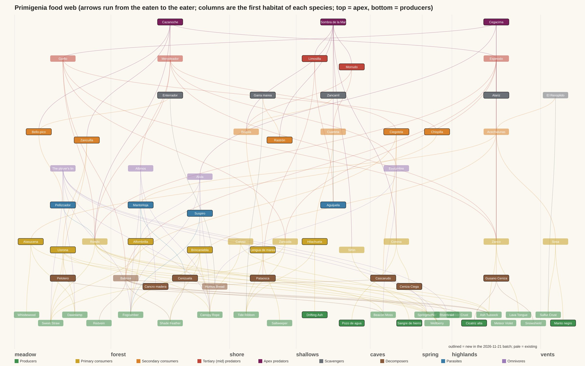

<!-- generated by tools/lore/foodweb_report.py from lore/foodweb/primigenia.json; do not edit -->

# Primigenia's food web

Tracker test L-TROPHIC. Brief: `docs/briefs/trophic-web.md`. Method: `lore/rules/derivation.md` (derive forward, biosphere before creatures). Data: `lore/foodweb/primigenia.json`; checker: `tools/lore/foodweb.py` (run by `tools/lore/validate.py`).

Contact sheet of the new species: `docs/evidence/lore/food-web-contact-sheet.jpg`.

## 1. Derivation sheet (summary)

Sheet: `lore/worlds/primigenia.derivation.json`, recomputed by `tools/lore/derivation.py`. Premises: Fixed by the owner or the canon: star L 1.05 Lsun, orbit 1.02 AU, planet 1.14 Mearth and 1.04 Rearth, 1.6 bar air with 21% O2 (volcanic island, wet fuels), 26 h day, 367 d year. Everything else below is derived from them in order.

| id | item | value | confidence |
|---|---|---|---|
| D1 | star luminosity | 1.05 Lsun | estimated |
| D2 | orbit | 1.02 AU | estimated |
| D3 | star mass | 1.05 Msun | estimated |
| D4 | insolation | 1.009 S_earth | derived |
| D5 | equilibrium temperature | 255.2 K | estimated |
| D6 | surface gravity | 1.05 g | derived |
| D7 | local days per year | 339 days | derived |
| D8 | atmosphere | 1.6 bar | estimated |
| D9 | greenhouse | 32 K | derived |
| D10 | partial pressure o2 | 0.336 bar | derived |
| D11 | air density | 1.58 | derived |
| D12 | sound speed | 340 m/s | derived |
| D13 | scale height | 8.0 km | derived |
| D14 | water boiling point | 113.3 C | derived |
| D15 | light gas escape | 7.7 | estimated |
| D16 | terminal velocity |  | derived |
| D17 | wind force | 1.58 | derived |
| D18 | scent diffusion | 0.63 | derived |
| D19 | moon period |  | derived |
| D20 | lapse rate | 6.2 K/km | derived |
| D21 | fire gate |  | derived |
| D22 | chemical energy |  | estimated |
| D23 | photosynthesis and pigments |  | derived |
| D24 | turbid water light |  | estimated |
| D25 | energy transfer |  | estimated |
| D26 | apex count |  | speculative |
| D27 | scavengers |  | derived |
| D28 | decomposers |  | derived |
| D29 | parasites |  | derived |
| D30 | empty niches |  | derived |

Two discrepancies in the existing world canon were exposed by recomputing it (reported as warnings, not changed): D16 terminal velocity (F4 says 25% lower, the same ratio gives about 18%) and D19 moon period (F6: 29.7 d at 450,000 km, Kepler gives 32.4 d; about 425,000 km would match).

## 2. Classification of what existed (before the batch)

19 creatures of world `primigenia` and 20 flora files (the brief says 21; `lore/flora/` holds 20).

### Creatures

| id | name | level | role | habitats | eats |
|---|---|---|---|---|---|
| `espinodo` | Espinodo | Tertiary (mid) predators | mid predator | highlands, meadow | rondo, zanco, zancuda, babosa, acechalunas, carrion |
| `garfio` | Garfio | Tertiary (mid) predators | mid predator | meadow, spring, shore, highlands | rondo, zanco, zancuda, babosa, carrion, chispilla |
| `merodeador` | Merodeador | Tertiary (mid) predators | mid predator | forest, highlands, caves, meadow | rondo, zanco, albinos, carrion, ecolumbre, ciegotela |
| `el_resoplido` | El Resoplido | Scavengers | scavenger | vents, highlands, caves | carrion, costra_de_azufre |
| `acechalunas` | Acechalunas | Secondary consumers | small predator | highlands, forest, caves | carrion, sosa, el_resoplido, cenizuela, gusano_ceniza, mantohoja |
| `brujula` | Brújula | Secondary consumers | small predator | shore, shallows | carrion, zancarril, lengua_de_marea |
| `cuarteta` | Cuarteta | Secondary consumers | small predator | shallows | carrion, aguijuela, hilachuela |
| `albinos` | Albinos | Omnivores | omnivore | forest, caves | nieblon, soga_de_dosel, carrion, cancro_madera |
| `alula` | Alula | Omnivores | seed disperser | forest, highlands | nieblon, soga_de_dosel, alfombrilla, brincaniebla |
| `ecolumbre` | Ecolumbre | Omnivores | omnivore | caves | musgo_faro, pan_de_humus |
| `player_lineage` | The player's lineage and cousins | Omnivores | omnivore | meadow, forest, highlands, shore, spring | perlilla, nieblon, soga_de_dosel, velilla, paja_dulce, madre_de_agua, trenza_de_ribera, carrion |
| `coloso` | Coloso | Primary consumers | browser | shore, spring | madre_de_agua, soga_de_dosel |
| `corona` | Corona | Primary consumers | filter feeder | caves, shallows | detritus, pozo_de_agua, ceniza_ciega |
| `rondo` | Rondo | Primary consumers | grazer | meadow, spring | paja_dulce, perlilla, madre_de_agua, soga_de_dosel, grama_de_ceniza, trenza_de_ribera |
| `sifon` | Sifón | Primary consumers | filter feeder | shallows, caves | detritus, sangre_de_hierro |
| `sosa` | Sosa | Primary consumers | algae scraper | vents, caves | costra_de_azufre, manto_negro |
| `zanco` | Zanco | Primary consumers | grazer | highlands | grama_de_ceniza, lengua_de_lava |
| `zancuda` | Zancuda | Primary consumers | grazer | shore, meadow | cinta_de_marea, paja_dulce |
| `babosa` | Babosa | Decomposers | detritivore | forest, caves, vents, highlands, meadow | detritus, pan_de_humus, musgo_faro, pluma_de_sombra, grama_de_ceniza, vetirroja, ceniza_roja |

### Flora

| id | name | level | role | habitats | eats |
|---|---|---|---|---|---|
| `pan_de_humus` | Humus Bread | Decomposers | fungal decomposer | forest, caves | detritus |
| `caramillo` | Whistlewood | Producers | photosynthetic | meadow, spring |  |
| `ceniza_roja` | Ember Crust | Producers | photosynthetic | highlands, vents |  |
| `cinta_de_marea` | Tide Ribbon | Producers | photosynthetic | shore, shallows, caves |  |
| `costra_de_azufre` | Sulfur Crust | Producers | chemosynthetic | vents |  |
| `grama_de_ceniza` | Ash Tussock | Producers | photosynthetic | highlands, meadow |  |
| `hierroflor` | Meteor Violet | Producers | photosynthetic | highlands |  |
| `lengua_de_lava` | Lava Tongue | Producers | mixotroph | highlands |  |
| `madre_de_agua` | Springmother | Producers | photosynthetic | spring |  |
| `musgo_faro` | Beacon Moss | Producers | photosynthetic | caves, forest |  |
| `nieblon` | Fogcomber | Producers | photosynthetic | forest |  |
| `paja_dulce` | Sweet Straw | Producers | photosynthetic | meadow |  |
| `perlilla` | Wellberry | Producers | photosynthetic | spring, meadow |  |
| `pluma_de_sombra` | Shade Feather | Producers | photosynthetic | forest, caves |  |
| `rodela_de_nieve` | Snowshield | Producers | photosynthetic | highlands |  |
| `salvisca` | Saltweeper | Producers | photosynthetic | shore |  |
| `soga_de_dosel` | Canopy Rope | Producers | photosynthetic | forest, spring |  |
| `trenza_de_ribera` | Riverbraid | Producers | photosynthetic | spring |  |
| `velilla` | Dawnlamp | Producers | photosynthetic | meadow, spring |  |
| `vetirroja` | Redvein | Producers | photosynthetic | meadow |  |

Habitat ranges were widened where a creature's own diet text needs it (for example merodeador hunts rondo at the meadow edge). `vents` (fumaroles and hot springs) is an eighth habitat added for the chemosynthetic producers; the seven main habitats are meadow, forest, shore, shallows, caves, spring, highlands.

## 3. Gaps before

Species per level and habitat, existing only:

| level | meadow | forest | shore | shallows | caves | spring | highlands | vents | total |
|---|---|---|---|---|---|---|---|---|---|
| Producers | 6 | 4 | 2 | 1 | 3 | 6 | 5 | 2 | 19 |
| Primary consumers | 2 | **0** | 2 | 2 | 3 | 2 | 1 | 1 | 7 |
| Secondary consumers | **0** | 1 | 1 | 2 | 1 | **0** | 1 | **0** | 3 |
| Tertiary (mid) predators | 3 | 1 | 1 | **0** | 1 | 1 | 3 | **0** | 3 |
| Apex predators | **0** | **0** | **0** | **0** | **0** | **0** | **0** | **0** | 0 |
| Scavengers | **0** | **0** | **0** | **0** | 1 | **0** | 1 | 1 | 1 |
| Decomposers | 1 | 2 | **0** | **0** | 2 | **0** | 1 | 1 | 2 |
| Parasites | **0** | **0** | **0** | **0** | **0** | **0** | **0** | **0** | 0 |
| Omnivores | 1 | 3 | 1 | **0** | 2 | 1 | 2 | **0** | 4 |

Gaps (zero cells and dead ends in the existing web):

- No apex predator anywhere; the top of every habitat is a mid predator (garfio, espinodo, merodeador). Coloso and the player have no predator by lore.
- One scavenger (el_resoplido, vents and slopes); none on the shore, forest floor, meadow or in the shallows although carcasses drift ashore (F20).
- One decomposer animal (babosa) and one fungus (pan_de_humus): none on the shore, spring, shallows or highlands; no dung, wrack or wood eaters.
- No parasite and no mutualist cleaner of any kind.
- No insect herbivores, pollinators, granivores or algae scrapers: insectivores and nectar flowers (velilla) had nothing to connect to. No zooplankton, so the filter feeders and jellies had no food item.
- Producers: none planktonic, none chemosynthetic below the fumarole crust, none in dark lava tubes, only green or violet-red pigments (no black or brown producer), no parasitic plant.
- Shallows had no mid predator; meadow and spring had no secondary consumer; forest had no primary consumer among animals.
- Plants without an eater: caramillo, salvisca, rodela_de_nieve, lengua_de_lava (hierroflor and vetirroja are defended).
- Existing animals with no predator written: sosa, corona, sifon, cuarteta, brujula, el_resoplido, ecolumbre (only the nocturnal creature, now acechalunas), alula.

## 4. Seed and random draw

Fixed seed `20261121` (`python random.Random(seed)`, `tools/lore/council/foodweb_draw.py`, record `lore/foodweb/primigenia.draw.json`). Each slot is a gap (level x role x habitat). The draw picks body plan (legs 0/2/4/6/8+, radial, sessile), size class (insect to giant) and activity (day, night, dawn and dusk, tidal) at random, 30% from a wide list; a draw is kept only if the planet physics can justify it (rejection rules in the script: arthropod size ceiling, apex needs mass, insectivores are small, detritivores and parasites are small, cleaners work by day, tidal activity needs a tidal habitat, no day activity in caves). The council (qwen draft, DeepSeek skeptic, Composer astrobiology referee) then derives each species around its accepted draw.

| slot | level | role | habitats | plan | size | activity | draws rejected |
|---|---|---|---|---|---|---|---|
| S01 | primary_consumer | grazer | forest, meadow | legs6 | insect | dawn_dusk | 0 |
| S02 | primary_consumer | granivore | meadow | legs4 | small | night | 0 |
| S03 | primary_consumer | nectarivore | meadow, spring | legs2 | small | dawn_dusk | 0 |
| S04 | primary_consumer | algae_scraper | shore | legs0 | small | night | 0 |
| S05 | primary_consumer | browser | forest | legs4 | small | night | 0 |
| S06 | primary_consumer | filter_feeder | shallows | legs0 | insect | dawn_dusk | 0 |
| S07 | secondary_consumer | insectivore | meadow | legs2 | small | dawn_dusk | 0 |
| S08 | secondary_consumer | insectivore | spring | legs4 | small | dawn_dusk | 3 |
| S09 | secondary_consumer | egg_thief | shore | legs4 | small | night | 0 |
| S10 | secondary_consumer | small_predator | caves | legs8plus | small | dawn_dusk | 0 |
| S11 | tertiary_consumer | mid_predator | shallows | legs0 | medium | dawn_dusk | 0 |
| S12 | apex_predator | apex_predator | forest, meadow | legs4 | large | night | 0 |
| S13 | apex_predator | apex_predator | shallows, shore | legs0 | large | tidal | 0 |
| S14 | apex_predator | apex_predator | highlands | legs2 | large | day | 0 |
| S15 | scavenger | scavenger | shore | legs8plus | small | tidal | 0 |
| S16 | scavenger | scavenger | forest, meadow | legs6 | insect | night | 0 |
| S17 | scavenger | scavenger | highlands | legs2 | large | day | 0 |
| S18 | decomposer | detritivore | meadow | legs6 | insect | day | 1 |
| S19 | decomposer | detritivore | forest | legs6 | insect | night | 0 |
| S20 | decomposer | detritivore | shore | legs8plus | small | night | 0 |
| S21 | decomposer | detritivore | caves | legs6 | insect | night | 0 |
| S22 | parasite | parasite | meadow | legs8plus | insect | day | 0 |
| S23 | parasite | parasitoid | forest | legs6 | insect | day | 0 |
| S24 | parasite | parasite | shallows | legs8plus | insect | night | 0 |
| S25 | tertiary_consumer | cleaner | shallows | legs0 | small | day | 3 |
| S27 | decomposer | detritivore | highlands | legs0 | insect | day | 0 |
| S28 | scavenger | scavenger | shallows, caves | legs8plus | small | night | 0 |
| S26 | secondary_consumer | cleaner | meadow, shore | legs2 | small | day | 0 |

## 5. New species

| id | name | kind | level | role | habitats | size | eats |
|---|---|---|---|---|---|---|---|
| `cazanoche` | Cazanoche | creature | Apex predators | apex predator | forest, meadow | large, 30 to 300 kg | carrion, merodeador, rondo, espinodo, bello_pico, zancuilla |
| `cegacima` | Cegacima | creature | Apex predators | apex predator | highlands | large, 30 to 300 kg | carrion, zanco, garfio, alula, alariz |
| `sombra_de_la_marea` | Sombra de la Marea | creature | Apex predators | apex predator | shallows, shore | large, 30 to 300 kg | brujula, corona, cuarteta, sifon, morrudo, rastron, limosilla |
| `limosilla` | Limosilla | creature | Tertiary (mid) predators | cleaner | shallows | small, 5 cm to 1 kg | aguijuela, pataosca |
| `morrudo` | Morrudo | creature | Tertiary (mid) predators | mid predator | shallows | medium, 1 to 30 kg | brujula, cuarteta |
| `alariz` | Alariz | creature | Scavengers | scavenger | highlands | large, 30 to 300 kg | carrion, detritus |
| `enterrador` | Enterrador | creature | Scavengers | scavenger | forest, meadow | insect-sized, under 5 cm | carrion, detritus, pan_de_humus |
| `garra_marea` | Garra marea | creature | Scavengers | scavenger | shore | small, 5 cm to 1 kg | carrion, cinta_de_marea, detritus |
| `zancarril` | Zancarril | creature | Scavengers | scavenger | shallows, caves | small, 5 cm to 1 kg | carrion, detritus |
| `bello_pico` | Bello-pico | creature | Secondary consumers | cleaner | meadow, shore | small, 5 cm to 1 kg | pellizcador, enterrador |
| `chispilla` | Chispilla | creature | Secondary consumers | insectivore | spring | small, 5 cm to 1 kg | alasucena |
| `ciegotela` | Ciegotela | creature | Secondary consumers | small predator | caves | small, 5 cm to 1 kg | babosa, corona, cascarudo |
| `rastron` | Rastrón | creature | Secondary consumers | egg thief | shore | small, 5 cm to 1 kg | carrion, garra_marea |
| `zancuilla` | Zancuilla | creature | Secondary consumers | insectivore | meadow | small, 5 cm to 1 kg | llorona, pelotero |
| `aguijuela` | Aguijuela | creature | Parasites | parasite | shallows | insect-sized, under 5 cm | cuarteta |
| `mantohoja` | MantoHoja | creature | Parasites | parasitoid | forest | insect-sized, under 5 cm | alfombrilla, cenizuela |
| `pellizcador` | Pellizcador | creature | Parasites | parasite | meadow | insect-sized, under 5 cm | rondo |
| `suspiro` | Suspiro | plant | Parasites | parasite | forest |  | nieblon |
| `alasucena` | Alasucena | creature | Primary consumers | nectarivore | meadow, spring | small, 5 cm to 1 kg | caramillo, perlilla, velilla |
| `alfombrilla` | Alfombrilla | creature | Primary consumers | grazer | forest, meadow | insect-sized, under 5 cm | musgo_faro, nieblon, paja_dulce |
| `brincaniebla` | Brincaniebla | creature | Primary consumers | browser | forest | small, 5 cm to 1 kg | pluma_de_sombra, nieblon, soga_de_dosel |
| `hilachuela` | Hilachuela | creature | Primary consumers | filter feeder | shallows | insect-sized, under 5 cm | cinta_de_marea, drifting_ash |
| `lengua_de_marea` | Lengua de marea | creature | Primary consumers | algae scraper | shore | small, 5 cm to 1 kg | cinta_de_marea, salvisca |
| `llorona` | Llorona | creature | Primary consumers | granivore | meadow | small, 5 cm to 1 kg | grama_de_ceniza, paja_dulce, perlilla, velilla |
| `cascarudo` | Cascarudo | creature | Decomposers | detritivore | caves | insect-sized, under 5 cm | detritus, dung, pan_de_humus |
| `cenizuela` | Cenizuela | creature | Decomposers | detritivore | forest | insect-sized, under 5 cm | detritus, pan_de_humus, pluma_de_sombra |
| `gusano_ceniza` | Gusano Ceniza | creature | Decomposers | detritivore | highlands | insect-sized, under 5 cm | rodela_de_nieve, cicatriz_alta |
| `pataosca` | Pataosca | creature | Decomposers | detritivore | shore, shallows | small, 5 cm to 1 kg | detritus |
| `pelotero` | Pelotero | creature | Decomposers | detritivore | meadow, spring | insect-sized, under 5 cm | detritus, dung, grama_de_ceniza |
| `cancro_madera` | Cancro madera | plant | Decomposers | fungal decomposer | forest |  | detritus |
| `ceniza_ciega` | Ceniza Ciega | plant | Decomposers | fungal decomposer | caves |  | detritus |
| `cicatriz_alta` | Cicatriz alta | plant | Producers | photosynthetic | highlands |  |  |
| `drifting_ash` | Drifting Ash | plant | Producers | photosynthetic | shallows |  |  |
| `manto_negro` | Manto negro | plant | Producers | photosynthetic | vents |  |  |
| `pozo_de_agua` | Pozo de agua | plant | Producers | chemosynthetic | shallows |  |  |
| `sangre_de_hierro` | Sangre de hierro | plant | Producers | chemosynthetic | caves |  |  |

## 6. Gaps after

| level | meadow | forest | shore | shallows | caves | spring | highlands | vents | total |
|---|---|---|---|---|---|---|---|---|---|
| Producers | 6 | 4 | 2 | 3 | 4 | 6 | 6 | 3 | 24 |
| Primary consumers | 5 | 2 | 3 | 3 | 3 | 3 | 1 | 1 | 13 |
| Secondary consumers | 2 | 1 | 3 | 2 | 2 | 1 | 1 | **0** | 8 |
| Tertiary (mid) predators | 3 | 1 | 1 | 2 | 1 | 1 | 3 | **0** | 5 |
| Apex predators | 1 | 1 | 1 | 1 | **0** | **0** | 1 | **0** | 3 |
| Scavengers | 1 | 1 | 1 | 1 | 2 | **0** | 2 | 1 | 5 |
| Decomposers | 2 | 4 | 1 | 1 | 4 | 1 | 2 | 1 | 9 |
| Parasites | 1 | 2 | **0** | 1 | **0** | **0** | **0** | **0** | 4 |
| Omnivores | 1 | 3 | 1 | **0** | 2 | 1 | 2 | **0** | 4 |

Quotas: Apex predators 3 new, Scavengers 4 new, Decomposers 7 new, Parasites 4 new; mutualists (cleaner, seed disperser, pollinator): 3 in total; chemosynthetic producers: 3.

## 7. Energy pyramid and spawn weights

Starting values, to be checked by tracker test L-TROPHIC (A27 ecology). About 10% of the energy passes up each level (Lindeman 1942; Pauly and Christensen 1995; D25), so apex animals are rare and grazers common. Scavengers, decomposers, parasites and omnivores are put on the level whose flux feeds them. Within a habitat, the level weight is split evenly among the species of that level, and the creature weights of each habitat are normalised to 100 (plants separately, by role).

| level | relative weight | why |
|---|---|---|
| primary consumer | 100.0 | base of the animal pyramid |
| decomposer | 100.0 | detritus flux about equals herbivory |
| omnivore | 30.0 | spans primary and secondary |
| secondary consumer | 10.0 | 10% of primary |
| parasite | 10.0 | lives on primary hosts |
| scavenger | 3.0 | carrion is the tail of every level |
| tertiary consumer | 1.0 | 10% of secondary |
| apex predator | 0.1 | 10% of tertiary; D26: about 6 adults island-wide |

Creature spawn weight by habitat (each column sums to 100):

| species | level | meadow | forest | shore | shallows | caves | spring | highlands | vents |
|---|---|---|---|---|---|---|---|---|---|
| Cazanoche | apex | 0.039 | 0.039 |  |  |  |  |  |  |
| Cegacima | apex |  |  |  |  |  |  | 0.041 |  |
| Sombra de la Marea | apex |  |  | 0.041 | 0.045 |  |  |  |  |
| Espinodo | tertiary | 0.131 |  |  |  |  |  | 0.137 |  |
| Garfio | tertiary | 0.131 |  | 0.41 |  |  | 0.415 | 0.137 |  |
| Limosilla | tertiary |  |  |  | 0.223 |  |  |  |  |
| Merodeador | tertiary | 0.131 | 0.394 |  |  | 0.41 |  | 0.137 |  |
| Morrudo | tertiary |  |  |  | 0.223 |  |  |  |  |
| Alariz | scavenger |  |  |  |  |  |  | 0.615 |  |
| El Resoplido | scavenger |  |  |  |  | 0.615 |  | 0.615 | 1.478 |
| Enterrador | scavenger | 1.181 | 1.181 |  |  |  |  |  |  |
| Garra marea | scavenger |  |  | 1.229 |  |  |  |  |  |
| Zancarril | scavenger |  |  |  | 1.339 | 0.615 |  |  |  |
| Acechalunas | secondary |  | 3.935 |  |  | 2.049 |  | 4.097 |  |
| Bello-pico | secondary | 1.968 |  | 1.366 |  |  |  |  |  |
| Brújula | secondary |  |  | 1.366 | 2.231 |  |  |  |  |
| Chispilla | secondary |  |  |  |  |  | 4.149 |  |  |
| Ciegotela | secondary |  |  |  |  | 2.049 |  |  |  |
| Cuarteta | secondary |  |  |  | 2.231 |  |  |  |  |
| Rastrón | secondary |  |  | 1.366 |  |  |  |  |  |
| Zancuilla | secondary | 1.968 |  |  |  |  |  |  |  |
| Albinos | omnivore |  | 3.935 |  |  | 6.148 |  |  |  |
| Alula | omnivore |  | 3.935 |  |  |  |  | 6.145 |  |
| Ecolumbre | omnivore |  |  |  |  | 6.148 |  |  |  |
| The player's lineage and cousins | omnivore | 11.806 | 3.935 | 12.29 |  |  | 12.448 | 6.145 |  |
| Aguijuela | parasite |  |  |  | 4.462 |  |  |  |  |
| MantoHoja | parasite |  | 3.935 |  |  |  |  |  |  |
| Pellizcador | parasite | 3.935 |  |  |  |  |  |  |  |
| Alasucena | primary | 7.871 |  |  |  |  | 13.831 |  |  |
| Alfombrilla | primary | 7.871 | 19.677 |  |  |  |  |  |  |
| Brincaniebla | primary |  | 19.677 |  |  |  |  |  |  |
| Coloso | primary |  |  | 13.656 |  |  | 13.831 |  |  |
| Corona | primary |  |  |  | 14.874 | 13.661 |  |  |  |
| Hilachuela | primary |  |  |  | 14.874 |  |  |  |  |
| Lengua de marea | primary |  |  | 13.656 |  |  |  |  |  |
| Llorona | primary | 7.871 |  |  |  |  |  |  |  |
| Rondo | primary | 7.871 |  |  |  |  | 13.831 |  |  |
| Sifón | primary |  |  |  | 14.874 | 13.661 |  |  |  |
| Sosa | primary |  |  |  |  | 13.661 |  |  | 49.261 |
| Zanco | primary |  |  |  |  |  |  | 40.965 |  |
| Zancuda | primary | 7.871 |  | 13.656 |  |  |  |  |  |
| Babosa | decomposer | 19.678 | 19.68 |  |  | 20.491 |  | 20.483 | 49.261 |
| Cascarudo | decomposer |  |  |  |  | 20.492 |  |  |  |
| Cenizuela | decomposer |  | 19.677 |  |  |  |  |  |  |
| Gusano Ceniza | decomposer |  |  |  |  |  |  | 20.483 |  |
| Pataosca | decomposer |  |  | 40.964 | 44.624 |  |  |  |  |
| Pelotero | decomposer | 19.677 |  |  |  |  | 41.495 |  |  |

| sum | | 100.0 | 100.0 | 100.0 | 100.0 | 100.0 | 100.0 | 100.0 | 100.0 |

Flora spawn weight by habitat (each column sums to 100; photosynthetic 10, chemosynthetic 3, mixotroph 2, decomposer 5, parasite 1, defended x0.2):

| species | role | meadow | forest | shore | shallows | caves | spring | highlands | vents |
|---|---|---|---|---|---|---|---|---|---|
| Sulfur Crust | chemosynthetic |  |  |  |  |  |  |  | 13.043 |
| Pozo de agua | chemosynthetic |  |  |  | 13.043 |  |  |  |  |
| Sangre de hierro | chemosynthetic |  |  |  |  | 6.977 |  |  |  |
| Cancro madera | fungal_decomposer |  | 9.96 |  |  |  |  |  |  |
| Ceniza Ciega | fungal_decomposer |  |  |  |  | 11.628 |  |  |  |
| Humus Bread | fungal_decomposer |  | 9.96 |  |  | 11.628 |  |  |  |
| Lava Tongue | mixotroph |  |  |  |  |  |  | 4.545 |  |
| Suspiro | parasite |  | 0.398 |  |  |  |  |  |  |
| Whistlewood | photosynthetic | 19.23 |  |  |  |  | 16.665 |  |  |
| Ember Crust | photosynthetic |  |  |  |  |  |  | 22.729 | 43.479 |
| Cicatriz alta | photosynthetic |  |  |  |  |  |  | 22.727 |  |
| Tide Ribbon | photosynthetic |  |  | 50.0 | 43.479 | 23.255 |  |  |  |
| Drifting Ash | photosynthetic |  |  |  | 43.478 |  |  |  |  |
| Ash Tussock | photosynthetic | 19.231 |  |  |  |  |  | 22.727 |  |
| Meteor Violet | photosynthetic |  |  |  |  |  |  | 4.545 |  |
| Springmother | photosynthetic |  |  |  |  |  | 16.667 |  |  |
| Manto negro | photosynthetic |  |  |  |  |  |  |  | 43.478 |
| Beacon Moss | photosynthetic |  | 19.922 |  |  | 23.256 |  |  |  |
| Fogcomber | photosynthetic |  | 19.92 |  |  |  |  |  |  |
| Sweet Straw | photosynthetic | 19.231 |  |  |  |  |  |  |  |
| Wellberry | photosynthetic | 19.231 |  |  |  |  | 16.667 |  |  |
| Shade Feather | photosynthetic |  | 19.92 |  |  | 23.256 |  |  |  |
| Snowshield | photosynthetic |  |  |  |  |  |  | 22.727 |  |
| Saltweeper | photosynthetic |  |  | 50.0 |  |  |  |  |  |
| Canopy Rope | photosynthetic |  | 19.92 |  |  |  | 16.667 |  |  |
| Riverbraid | photosynthetic |  |  |  |  |  | 16.667 |  |  |
| Dawnlamp | photosynthetic | 19.231 |  |  |  |  | 16.667 |  |  |
| Redvein | photosynthetic | 3.846 |  |  |  |  |  |  |  |

## 8. Consistency

`python3 tools/lore/foodweb.py check`: 0 error(s), 2 warning(s). Checked: no dangling ids, every consumer has a food source that shares its habitat and sits below it, nothing is a dead end except apex animals, coloso and the player, weights sum to 100 and fall from primary to apex, batch quotas, at least one species per level in each main habitat.

- warning: hierroflor: defended plant, only decomposers use it
- warning: suspiro: defended plant, only decomposers use it

## 9. Playable hooks (new creatures)

| species | skills (observe to learn) | weakness (threat counter) | secret | food and gifts |
|---|---|---|---|---|
| Cazanoche | Moonlit Focus (Engage); Scent Path (Control); Ground Crawl (Basic) | Dazzled by sudden bright flashes or auroral pulses (F10) | Albinos variant lacks tapetum reflection, forcing strict daytime rest in deep hollows | merodeador, rondo, carrion |
| Cegacima | Thermal Soar (Passive); Sky Lock (Basic); Wind Cut (Engage) | Grounded in calm air, must wait for wind or thermals. | High ridge viewpoint | Carnivore: Zanco, Rondo, carrion |
| Sombra de la Marea | Undulatory Lunge (Engage); Current Sense (Basic); Mud Crawler (Poke) | Slower acceleration on open, flat sand. | Electroreceptive rostrum tip can be harvested to build 'Sense' gear (Passive/Basic) that highlights prey in water. | Carnivore: drifting carcasses, brujula, cuarteta, and young grazers that wade. |
| Limosilla | Electro-buzz (Engage); Gentle scrape (Basic); Silt glide (Basic) | Sudden pressure spikes from lightning or boat wakes disrupt its electroreception. | Parasite cache: find a cluster of cleaned parasites lodged in a lava crevice after a storm. | ectoparasites, dead epidermis, mucus, carcass particles (corona), zooplankton, c |
| Morrudo | Silt Glide (Basic); Static Sense (Poke); Low Light Lunge (Engage) | Cannot stop quickly on hard rock; slides into spines and loses balance | Luminescent gut contents: digested carcass bits glow faintly through its belly, revealing recent kills. | Carnivore: flesh of Cuarteta, Brújula, drifting carcass fragments, and salt-rich |
| Alariz | Thermal Soar (Control); Carion Sight (Poke); Light Frame (Defence) | Ground-bound in thick fog or windless dawn when thermals fail | Fossilized wing bones found in the sunken lava tube | carrion, bone, detritus |
| Enterrador | Stable Crawl (Basic); Bury & Liquefy (Engage); Moon Lure (Social) | Exposed leg joints snap under heavy impact; vulnerable to espinodo spine volleys. | Discover burial pits to unlock 'Preserved Carrion' storage mechanic | carrion, detritus, pan_de_humus, rondo |
| Garra marea | Wrack Scuttle (Basic); Scent Trail (Engage); Tide Hiss (Control) | Slow on dry inland terrain due to high weight-to-surface-area ratio. | Molting Ground | Carrion, detritus, drifting carcass particles, salt spray, small benthic inverte |
| Zancarril | Climb (Basic); Shred (Engage); Scavenge Sense (Poke) | Slow movement speed on smooth sand. | Secret: Albinos lack shell pigment. | carrion, detritus, plankton |
| Bello-pico | Hover (Engage); Cling (Defence); Probe (Poke) | Cannot fly against wind gusts (D19). | Nest woven from shed Rondo hair and sea grass. | Ectoparasites, insect larvae, salt crusts |
| Chispilla | Adhere (Basic); Power Leap (Engage); Twilight Focus (Basic) | Pads lose suction on dry, dusty rock. | Dawn chorus: they click in soft rhythms to coordinate hunting. | Carnivore: insect, larva, detritus. |
| Ciegotela | Grip & Tremor Sense (Passive); Silk Snare (Control); Crepuscular Ambush (Basic) | Disoriented by loud, sudden roars that mask tremors | a hidden cave | babosa, ecolumbre, corona, carcass |
| Rastrón | Night Sniff (Basic); Shell Soften (Engage); Grip Climb (Defence) | Loud noises disrupt tracking; sensitive to strong chemical sprays. | Find a tide pool with a cluster of pale eggs to unlock the 'Shell Soften' move early. | carrion, detritus, plankton, eggs |
| Zancuilla | Glide (Control); Listen (Basic); Clean (Social) | Vulnerable during wind-up and landing; slow to regain altitude. | Rare albinos glow white in the mist. | Insects on paja_dulce, ectoparasites on rondo |
| Aguijuela | Moon-sting (Signature); Sense pulse (Poke); Lunge (Basic) | Inactive at new moon; cannot hunt without moonlight. | Larvae filter-feed on drifting carcass particles. | Host blood, mucus, and gill tissue |
| MantoHoja | Drift-Dash (Basic); Silent Strike (Poke); Foliage Blend (Defence) | Wing joints stiffen in cold damp, slowing takeoff | Hidden under a rotting log, a cluster of empty, translucent egg shells. | leaf_insect_nymphs |
| Pellizcador | Anchor grip (Passive); Tap feed (Basic); Sun-bask (Control) | Exposed to overhead pecking. | Observe 3 Pellizcador clusters on a Rondo. Unlocks move: 'Scent track' (Poke) and reveals their role in the food web. | Carnivore; blood, lymph, and skin secretions of grazers. |
| Alasucena | Slow hover (Control); Nectar feed (Basic); Twilight focus (Passive) | Clumsy on ground; slow acceleration makes takeoff predictable | Nocturnal morph: turns entirely black, gains +20% befriend in absolute dark; loses UV vision. | Producer: velilla, caramillo, perlilla nectar; salt licks |
| Alfombrilla | Drift Glide (Basic); Fog Vision (Passive); Leaf Swarm (Engage) | Stamina drains fast in dry midday air. | Collect all six legs from carcasses to unlock Silk Bind. | Herbivore: soft leaf tissue of nieblon, paja_dulce, and musgo_faro. |
| Brincaniebla | Dusk Gaze (Poke); Soft Landing (Defence); Sustained Pace (Basic) | Dazzled by sudden bright flashes and direct moonlight on snow |  | to be written |
| Hilachuela | Undulate (Passive); Strain (Passive); Dusk Surge (Passive) | Exposed on open sand; slow to turn. | Gill rakers can filter toxic sulfur particles (risk/reward). | cinta_de_marea, drifting carcass particles, plankton |
| Lengua de marea | Adhere (Defence); Glow-Track (Poke); Night Shift (Passive) | Dries out and loses grip if exposed >4 hours without tide or fog | Grit digestion: they swallow crushed basalt to power their radula. | cinta_de_marea, salvisca, pan_de_humus, salt, drifting carcass bits |
| Llorona | Nocturnal Focus (Basic); Seedcrack (Engage); Cache (Control) | Blinded by sudden bright flashes or lightning strikes | Nocturnal variant | paja_dulce, velilla, perlilla, grama_de_ceniza |
| Cascarudo | Short Glide (Basic); Scent Trail (Poke); Grip Crawl (Basic) | Loud roars disrupt wing control | nocturnal creature | rondo dung, carcass leavings, pan_de_humus fungal growths, detritus |
| Cenizuela | Low crawl (Basic); Silent glide (Control); Acid digest (Engage) | Exposed on open ground; dense air makes running costly (F4, D16). | Nocturnal variant bonus applies: befriend attempts in darkness gain +12 charm. | pan_de_humus, pluma_de_sombra, detritus |
| Gusano Ceniza | Deslizar (Basic); Raspar (Engage); Blindar (Passive) | Exposed on open rock; vulnerable to beak strikes. | Rock Armour | Detritivore: winter-killed rosette litter, frozen carcass bits, and basalt grit |
| Pataosca | Carapace brace (Defence); Tide-walk (Basic); Scent-track (Engage) | Vulnerable to crushing from above; shell limits flexibility. | A Pataosca carrying `costra_de_azufre` on its carapace unlocks 'Sulfur Gland' (fire resistance). | wrack, carcass_bits, fungal_spores, mineral_crusts |
| Pelotero | Wind-Anchor (Defence); Rapid Breakdown (Basic); O2-Burst (Engage) | Stationary for 3 seconds, vulnerable to bite attacks | Albino variant lacks melanin, thrives in cooler dawn fog but burns if caught in midday clear skies. | grama_de_ceniza stems, rondo dung, meadow detritus |

## 10. Not done

- Game import is milestone 6: no snapshot, event or `core/` change. Spawn weights are data only.
- All new entries are `draft`; the owner sets `canon`.
- Whether gameplay numbers (weights) feel right is open until tracker test L-TROPHIC.
